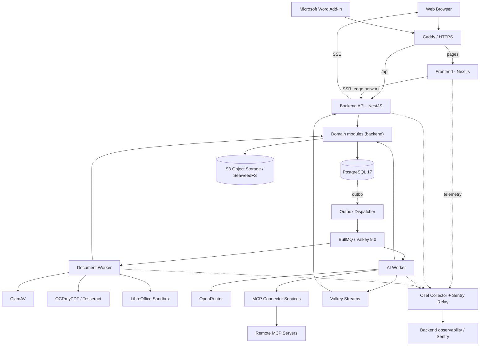

# LEXON
## System Architecture Specification

| Field | Detail |
|---|---|
| **Document** | LEX-ARC-001 |
| **Version** | 1.7 |
| **Status** | **PROPOSED — for architecture approval** |
| **Date** | 31 October 2026 |
| **Supersedes** | v1.6 (31 October 2026) |
| **Product** | Lexon — Indonesian Legal AI Workspace |
| **Technology reference** | [Technology Stack Specification v1.7](./LEXON-01-TECHNOLOGY-STACK.md) · LOCKED (subject to validation prerequisites) |
| **Design reference** | [Design System v1.0](./LEXON-03-DESIGN-SYSTEM.md) |
| **Classification** | Internal · Product & Engineering |

## 1. System Overview

Lexon is an AI-assisted legal work platform that combines **Chat**, **Tabular Review**, and a **Document Editor** with document and project management and organization-based collaboration. External services are integrated through connectors based on the Model Context Protocol (MCP). The architecture is designed to give a unified experience, clear data separation, and AI and document processing that can run outside the user request cycle.

The product experience is oriented toward the standard of professional legal AI applications, with **Legora and Harvey** as category benchmarks. The technical architecture in this document is based on Lexon's own requirements and technology choices.

**Architecture style:** separate frontend and backend in one monorepo, with a root folder structure that follows Mike OSS (`backend/`, `frontend/`, `word-add-in/`). The frontend (Next.js) only serves the interface; all business logic and data access live in the backend (NestJS). Inside the backend, domains remain modules in one codebase accessed through application services, while certain compute work is executed by separate workers that are entrypoints of the same backend codebase. The initial design runs on one Linux VPS through Docker Compose.

**Three defining principles:**

1. **Answers must be traceable.** Every document-based answer carries citations to the source page/paragraph, verified by the system (§4.3).
2. **Client documents are the most sensitive data.** Sending to models, logging, retention, and deletion are explicitly controlled (§6).
3. **Uploaded content is untrusted.** Files are scanned, processed inside isolated boundaries, and their content is treated as data, not instructions (§5.2).

**Initial language scope (MVP):** English for the interface, content, system prompts, reference documents, and engineering documents. Indonesian is prepared through configuration (§4.3), without schema changes.

**MVP product capabilities.** Besides Chat, Tabular Review, and the Document Editor, the MVP includes:
- Projects and the document Library
- **Workflows** (titled AI work procedures a user can invoke), together with **Quick Actions**
- **Playbooks** (contract review rules)
- **Memory** (preferences and facts saved per user/project and reused by the AI)
- **Subagents** (delegating sub-tasks from one AI run)
- **Web research** (web search as an AI tool with source citations)
- MCP connectors
- **personal data export**

Out of scope:
- user-supplied API keys (BYOK)
- organization-level model provider keys
- a desktop application
- integration with third-party, foreign-jurisdiction case-law databases

## 2. Logical Architecture



*The diagram shows the main logical dependencies. Data, queue, and storage connections can be used by several backend runtimes through the same infrastructure interfaces. The frontend has no connection to PostgreSQL, Valkey, or object storage.*

### 2.1 Application runtimes

| Component | Main function | Interface |
|---|---|---|
| **Frontend** | UI and server-side rendering. Calls the Backend API: from the browser through `/api/*`, from the Next.js server through the `edge` network. It has no access to the database, Valkey, or storage, and holds no server secrets | HTTPS / Next.js App Router |
| **Backend API** | All HTTP APIs, sessions and authentication (Better Auth), validation, authorization, synchronous operations, MCP connector administration, and SSE delivery (stream hub) | HTTPS / NestJS controllers |
| **AI Worker** | Generation, tool execution, and AI work processing through the AI Run Engine (§4.7). The only job runtime that talks to the model provider. A `backend/` entrypoint | BullMQ jobs; database and event streams |
| **Document Worker** | Scanning, validation, extraction, OCR, chunking, and document processing. **No internet access** because it processes untrusted files. A `backend/` entrypoint | BullMQ jobs; database and object storage |
| **LibreOffice Sandbox** | Office format conversion in an isolated environment | Internal service without internet access |
| **ClamAV** | Malware scanning of uploads | Internal service (`clamd`) |
| **Outbox Dispatcher** | Moves PostgreSQL outbox entries into BullMQ. One active instance (`pg_try_advisory_lock`), woken by `LISTEN/NOTIFY` with a polling fallback. A `backend/` entrypoint | PostgreSQL; Valkey |
| **OTel Collector + Sentry Relay** | The only export path for telemetry and errors. They provide a second layer of sensitive-attribute removal and keep egress-less runtimes observable | OTLP; Sentry protocol |
| **Word Add-in** | The Lexon interface inside Microsoft Word; a static bundle from `word-add-in/` served by Caddy | Lexon API over HTTPS (§8) |

**MCP Connector Services** is an application module used by the Backend API and the AI Worker, not a separate deployment runtime. The Backend API manages connector configuration and authorization flows; the AI Worker runs the available tools within the context of AI work.

The backend runtimes (API, AI Worker, Document Worker, Dispatcher) come from one codebase and share business modules. Each entrypoint has its own root module that loads only the modules it needs (§3.6). Runtime separation isolates workloads and network boundaries; it does not create fully independent business services. The frontend–backend separation is a trust boundary: the frontend never touches server data or secrets.

### 2.2 Container networks

Docker Compose uses four networks. Networks marked *internal* have no outbound route; components that need egress must join the `egress` network.

| Network | Members | Internet access |
|---|---|---|
| `edge` | Caddy, Frontend, Backend API, OTel Collector, Sentry Relay | Inbound traffic through Caddy |
| `egress` | Backend API, AI Worker, ClamAV signature updater (`freshclam`), OTel Collector, Sentry Relay | The only outbound path. The Backend API and AI Worker use a validated HTTP client (§5.1); host firewall rules restrict the signature updater's destinations and the Collector's and Relay's export destinations |
| `core` (internal) | Backend API, AI Worker, Document Worker, Outbox Dispatcher, PostgreSQL, Valkey, object storage, OTel Collector, Sentry Relay | None |
| `sandbox` (internal) | Document Worker, LibreOffice Sandbox, `clamd` | None |

The Frontend is only on `edge`: it has no route to `core` (database, Valkey, storage), no egress, and no server secrets. A compromise of the Next.js process therefore gives no direct path to data. The Collector and Relay join `edge` only to receive telemetry from the Frontend; neither accepts connections from outside through Caddy.

The Document Worker has no outbound route. It sends its traces, metrics, and errors to the OTel Collector and Sentry Relay on the `core` network, which forward them out after removing sensitive attributes. The LibreOffice Sandbox and `clamd` send no telemetry directly; the Document Worker reports their status and duration.

Telemetry paths for the frontend:
- **Next.js server:** telemetry goes to the Collector and Relay on `edge`.
- **Browser:** errors go through the Sentry `tunnel`, a Backend API endpoint `POST /api/telemetry/sentry-tunnel` that forwards them to Sentry Relay. The endpoint has rate limiting, a body size limit, and a DSN allowlist.

## 3. Application Structure

### 3.1 Domains and responsibilities

| Domain | Responsibility |
|---|---|
| **Identity & Access** | Identity, sessions, membership, organization roles, and permission decisions on resources |
| **Organizations & Workspaces** | User work context, organizations, membership, and workspace settings |
| **Projects** | Grouping of work (matters), instructions, relations between conversations and documents, and ethical walls |
| **Chat** | Conversations, messages, AI runs, streaming state, tool approval, interaction history, and **subagents** (child runs delegated from a parent run, with depth limits, token budgets, and permissions that never exceed the parent run) |
| **Documents** | Upload, metadata, file versions, pipeline status, extraction, OCR, and document lifecycle |
| **Knowledge & Retrieval** | Chunking, keyword index (FTS and trigram), retrieval, context assembly, and citation verification |
| **Tabular Review** | Row/column-based review, document sources, configuration, cell status, and analysis results |
| **Editor** | DOCX drafting, document versions, comments, tracked changes, and applying AI suggestions |
| **Connectors & MCP** | External service connections, credentials, tool catalog, execution policies, action approval, and tool result recording |
| **Workflows** | Workflow catalog (built-in, organization, personal), Quick Actions, workflow sharing, and using workflows in Chat and Tabular Review |
| **Playbooks** | Contract review rules (standard positions, fallbacks, escalation), import, and applying them to document reviews |
| **Memory** | Per-user and per-project memory: creation (explicit, and AI-proposed with approval), scope, editing, deletion, and injection into AI context |
| **Research** | Web research as an AI tool: queries to a search provider, page fetching through the validated HTTP client (§5.1), results as untrusted data with URL citations |
| **Usage & Quotas** | Model usage recording, per-organization quotas, and cost metering |
| **Audit** | Append-only audit records of access, AI actions, exports, and permission changes; personal data export for users (§6.3) |
| **Platform Services** | Jobs, operational notifications, and cross-domain observability |

Each domain is one NestJS module in `backend/src/modules/<domain>`. A module owns the business rules for its own resources and exports only the application service that forms its contract. Cross-module communication goes through those exported services; HTTP controllers and BullMQ processors are thin execution adapters.

### 3.2 Identity and authorization

**Better Auth** is the base component for authentication and session management, mounted in the backend (NestJS) at `/api/auth/*`. The frontend uses the `better-auth/react` client on the same origin. NestJS's built-in body parser is disabled so Better Auth handles the raw body, and a JSON parser is mounted for other routes. The adapter is the community library `@thallesp/nestjs-better-auth`; a thin internal adapter over `toNodeHandler` is built only if S6 shows an incompatibility with NestJS 12 or ESM. The integration uses these plugins:

- **Organization:** organizations, members, invitations, and organization-level roles.
- **Admin:** platform-level administrative functions.
- **Two-Factor:** 2FA; mandatory for platform administrators and optionally required per organization.
- **Bearer:** tokens for non-cookie clients, mainly the Word add-in (§8).

The two administration scopes are separated:

- **Platform administrator:** manages Lexon's administrative functions. Has no built-in access to customer document or conversation content (see *break-glass*, §6.2).
- **Organization owner/admin/member:** manages or participates in the organization within their scope.

Permissions on **Project, Chat, Document, Tabular Review, and Editor** are decided by **Lexon resource-level policies** (NestJS guards and policy services). The inputs are identity, organization/project context, ownership, and access grants. Permissions are validated on the server whenever a resource is read or changed, including by workers processing related work. The frontend makes no permission decisions; interface checks are only for user experience.

**Layered tenant isolation:**

1. **Application layer:** resource-level policies, through one central *authorization predicate builder*. Every query that touches documents, chunks, or conversations (including keyword search and retrieval) must use this builder; there is no unfiltered query path.
2. **Database layer:** PostgreSQL RLS on every tenanted table (`org_id`) in the `app` schema (details below).
3. **Testing:** CI runs negative cross-tenant and cross-project tests for every read path (API, worker, retrieval, SSE, export). It also tests that queries without tenant context return zero rows.

**Database roles and schemas.**

| Role | Used by | Privileges |
|---|---|---|
| `lexon_migrator` | Drizzle Kit (migrations) | Owner of the `app`, `auth`, and `ops` schemas; never used at runtime |
| `lexon_app` | Backend API, AI Worker, Document Worker, Outbox Dispatcher | No `BYPASSRLS` and not a table owner. Has DML on the `app` schema (subject to RLS) and on `ops`, plus per-column `SELECT` on non-secret columns of `auth.user`, `auth.organization`, and `auth.member` for permission decisions |
| `lexon_auth` | The Better Auth adapter only | DML only on the `auth` schema; no privileges on the `app` and `ops` schemas |

The Frontend and Word add-in have no database role and do not connect to PostgreSQL.

- **Better Auth tables** (user, session, account, verification, organization, member, invitation, two-factor) live in the `auth` schema without tenanted RLS, because Better Auth runs its own queries without an `app.org_id` context. The Better Auth adapter in the backend uses its own connection pool with the `lexon_auth` role. Protection comes from role separation and per-column privileges: `lexon_app` cannot read session tokens, password hashes, or 2FA secrets. The schema configuration of the Better Auth Drizzle adapter is verified during implementation.
- **Operational tables** without client content (outbox, dispatcher status, deletion ledger) live in the `ops` schema. They hold only ids and metadata (K3, §6.1) and have no tenanted RLS, so the Outbox Dispatcher can work across tenants.
- **Context wrapper.** All access to the `app` schema goes through `withTenant(ctx, fn)` in the backend database module (`backend/src/infrastructure/db`). It opens a transaction and sets `set_config('app.org_id', $1, true)` and `set_config('app.user_id', $2, true)`.
  - The `set_config` form is used because `SET LOCAL` does not accept parameters. The `true` argument scopes the value to the transaction, so it is safe for a connection pool.
  - The context (`orgId`, `userId`) is derived by a guard from the Better Auth session and passed explicitly to `withTenant`; there is no implicit global context.
  - The raw database client is not exported from that module. The ESLint rule `no-restricted-imports` forbids importing the driver outside that module, and forbids `pg` and `drizzle-orm` in `frontend/` and `word-add-in/`.
- **Fail-closed.** RLS policies have the form `org_id = NULLIF(current_setting('app.org_id', true), '')::uuid`. The `NULLIF` covers two cases:
  - On a connection that has never set the value, `current_setting(..., true)` returns NULL.
  - On a reused pool connection, after a transaction that used `set_config(..., true)` ends, the value becomes an empty string, not NULL, so a direct `::uuid` cast would throw an error.

  `NULLIF` turns both into NULL, so the comparison is never true and no rows pass. Mandatory test (S6): a query without context returns zero rows without error, on both a fresh connection **and** a reused connection. Policies are kept as simple equality comparisons so they keep using indexes.
- **Workers and the dispatcher** set the context from the validated job payload. Cross-tenant work (reconciliation, retention, deletion ledger replay) uses narrow, audited `SECURITY DEFINER` functions with a fixed `search_path`, not a role without RLS.

**Ethical wall:** access to a project/matter is based on explicit membership. An organization role does not automatically grant access to project content (configurable per organization). A per-project deny list overrides any role (deny-overrides).

The plugin usage in this section is a **design detail of the Better Auth integration**, not a technology decision outside the locked stack.

### 3.3 MCP integration

Lexon provides an **MCP client** capability to connect the AI assistant to tools served by remote MCP servers. Connections are managed through the **Settings → Connectors** interface and accessed through application services, with support for:

- Connector registration using a validated server URL, connector listing, configuration updates, disabling, and deletion.
- OAuth 2.0 authentication including the authorization flow and token refresh (with strict *issuer* validation of OAuth metadata, RFC 8414), and bearer tokens or custom headers for relevant connections.
- Discovery and synchronization of tool metadata, input schemas, and enabled/disabled settings per connector and per tool.
- A **read-only** policy to prevent data-modifying operations, and an option for **user approval before a write action** runs.
- Tool execution through the AI Worker with the user's identity and connector access limits checked on the server.
- Reporting of tool call status, results, and errors as part of the AI conversation.

Connections and credentials are bound to their owner and access scope. Organization membership alone does not grant the right to use another user's personal connection. Control over shared connections, if enabled, must go through an explicit access policy.

### 3.4 Monorepo structure

The root structure follows Mike OSS: application folders sit directly at the root and each application has its own `package.json`. Lexon names the add-in folder `word-add-in/` (the reference repo uses `word-addin/`). The main differences from Mike OSS:
- a pnpm workspace with `shared/` as the only shared package;
- a backend with four entrypoints instead of one process.

```text
lexon/
├── backend/                       # NestJS 12 (ESM): API, domain modules, worker entrypoints
│   ├── src/
│   │   ├── entrypoints/           # one root module + bootstrap per runtime (§3.6)
│   │   │   ├── api/               # Backend API: HTTP + SSE
│   │   │   ├── ai-worker/         # Executes AI jobs (AI Run Engine, §4.7)
│   │   │   ├── document-worker/   # Scan, OCR, extraction, chunking
│   │   │   └── dispatcher/        # Outbox → BullMQ (one active instance)
│   │   ├── modules/               # One NestJS module per domain (§3.1)
│   │   │   ├── identity-access/
│   │   │   ├── organizations/
│   │   │   ├── projects/
│   │   │   ├── chat/
│   │   │   ├── documents/
│   │   │   ├── knowledge/
│   │   │   ├── tabular-review/
│   │   │   ├── editor/
│   │   │   ├── connectors/
│   │   │   ├── workflows/
│   │   │   ├── playbooks/
│   │   │   ├── memory/
│   │   │   ├── research/
│   │   │   ├── usage/
│   │   │   ├── audit/
│   │   │   └── platform/
│   │   └── infrastructure/
│   │       ├── db/                # Drizzle schema, withTenant, predicate builder, RLS policies
│   │       ├── storage/           # S3 port + object encryption (§5.6)
│   │       ├── queue/             # BullMQ, Valkey, stream hub
│   │       ├── ai/                # AI SDK + OpenRouter, model/provider allowlist
│   │       └── telemetry/         # OpenTelemetry, Sentry
│   ├── drizzle/                   # Versioned SQL migrations (including RLS and roles)
│   ├── test/
│   ├── Dockerfile                 # targets: api, ai-worker, dispatcher, document-worker
│   └── package.json
├── frontend/                      # Next.js 16: UI and SSR only
│   ├── src/app/                   # App Router; route groups (auth) and (workspace)
│   ├── src/components/            # shadcn/ui (Base UI), assistant-ui, DOCX editor, Tabular Review grid
│   ├── src/lib/                   # typed API client, Better Auth client, ChatTransport
│   ├── Dockerfile
│   └── package.json
├── word-add-in/                   # Office.js + React + Webpack (static bundle)
├── shared/                        # @lexon/contracts: Zod schemas, event contracts (versioned), EditorPort interface
├── evals/                         # AI quality evaluation datasets and harness
├── infra/                         # Production deployment: Caddy, sandbox, backup, OTel Collector & Sentry Relay
├── docs/                          # System specifications
├── docker-compose.yml             # Local development stack
├── pnpm-workspace.yaml
└── package.json
```

**Dependency rules** (enforced by ESLint and checked in CI):

- `frontend/` and `word-add-in/` may import only `shared/`; neither may import `backend/`.
- `backend/` does not import `frontend/` or `word-add-in/`.
- `evals/` imports `backend/` only through one public evaluation entry exported by the backend package (enough to boot a standalone application context with the AI Run Engine, §4.7, §7.2), never module internals or `infrastructure/*`.
- `shared/` depends on no other folder. It contains only types, schemas, and interfaces (no business logic and no Node-specific APIs), so it can be used in the browser and the add-in.
- Inside `backend/`:
  - other domain modules are imported only through their public `index.ts` barrel;
  - the `pg` driver and Drizzle are used only in `infrastructure/db`;
  - the AI SDK and provider are used only through `infrastructure/ai`.
- `EditorPort` is defined in `shared/`. The EigenPal adapters live in `frontend/` (the in-browser editor) and in the backend `editor` module (`editor-api`, §4.4).

In `frontend/`, the Next.js route groups **`(auth)`** and **`(workspace)`** organize the pages. Business logic is placed in backend domain modules, so controllers and workers can reach it consistently.

This structure is the initial logical organization; subfolders are created as modules need them.

### 3.5 Frontend–Backend boundary

- **Routing and origin.** Caddy forwards `/api/*` to the Backend API and every other path to the Frontend, so the browser deals with only one public origin. The Better Auth session cookie needs no CORS or cross-subdomain settings. In local development, Next.js `rewrites` forward `/api/*` to the backend.
- **Calls from the browser.** The Better Auth client, the typed API client (from `shared/`), and the `ChatTransport` (§4.1) call `/api/*` directly, including the SSE endpoint. The SSE path is served by the Backend API without going through Next.js.
- **Calls from the Next.js server.** Server Components call the Backend API through `BACKEND_INTERNAL_URL` on the `edge` network, forwarding the `cookie` header from the user's request. Next.js does not access the database or storage.
- **Authentication in the frontend.** The Next.js 16 `proxy.ts` (Node.js runtime; replaces `middleware.ts`) only checks for the presence of a session cookie for fast redirects; access decisions are always made by the backend.
- **Prohibitions.** Route Handlers and Server Actions are not used for business logic or data access; only for presentation needs (for example, redirects or display preferences).
- **Contracts.** Request/response schemas and the streaming event contract live in `shared/` (Zod, versioned).
  - The backend validates input with these schemas on route decorators (Standard Schema support in NestJS 12; verified in S6).
  - The frontend uses the same schemas for types and form validation (React Hook Form with the Zod resolver; data fetching through TanStack Query).
- **Version compatibility.** The Word add-in is released separately from the web and can lag behind on clients. Incompatible API contract changes are done as a new version with a transition period.
- **CORS.** Only the Word add-in origin (on `/api/*`) and the S3 data-plane host (§5.1) need CORS; there is no CORS for the main frontend.

### 3.6 Backend entrypoints and module composition

The backend is built from one codebase and runs as four processes. Each entrypoint has its own root module; the workers and dispatcher use a NestJS *application context* (no HTTP listener).

| Entrypoint | Loads | Deliberately does not load |
|---|---|---|
| `api` | All domain modules, controllers, Better Auth, the stream hub; queues only as a *producer* | BullMQ processors |
| `ai-worker` | AI Run Engine (§4.7), Chat (including subagents), Knowledge & Retrieval (retrieval), Tabular Review, Connectors (tool execution), Workflows and Playbooks (read), Memory, Research, Usage, Audit; `ai-*` processors | HTTP controllers, Better Auth |
| `document-worker` | Documents, Knowledge & Retrieval (chunking), XLSX export; `doc-*` processors | `infrastructure/ai` (model client), Better Auth, HTTP controllers |
| `dispatcher` | Platform Services (outbox) | Other domain modules |

This means the Document Worker restrictions (no internet, no model provider) are enforced twice: by the container network (§2.2) and by module composition. One backend `Dockerfile` has the targets `api`, `ai-worker`, `dispatcher`, and `document-worker`. The `document-worker` target adds the OCR toolchain (OCRmyPDF, Tesseract) and its supporting libraries.

## 4. Data & Integration Architecture

| Component | Data/operations it is responsible for |
|---|---|
| **PostgreSQL** | User/resource references, organizations, permissions, conversations, metadata and versions, chunks, review state, usage events, audit log, durable job state |
| **Object storage (S3 / SeaweedFS)** | File objects, source documents, OCR results, and document artifacts; active-area content encrypted by the application per organization (§5.6) |
| **Valkey / BullMQ** | Job queues, scheduling, dispatch, retries, rate limiting, and process coordination |
| **Valkey Streams** | Event delivery between runtimes for real-time streaming |
| **SSE** | Event delivery connection from the Backend API to clients |
| **OpenRouter** | AI model gateway called by the AI Worker (with a zero-retention policy, §6.2) |
| **MCP connector services** | Connector identity, encrypted authorization configuration, tool catalog, policies, and approval status, stored in PostgreSQL |
| **Remote MCP servers** | Provide external tools called by the AI Worker over the Streamable HTTP transport |

**Main data rules:**
- PostgreSQL holds the authoritative business state; binary objects live in S3 storage.
- File identity and permissions are determined by metadata and application policy.
- Real-time events and queues do not replace permanent business records.
- Object storage is accessed only through the **S3 port** in `backend/src/infrastructure/storage` and is tested with contract tests, so its implementation can be replaced.
- Object encryption and decryption (§5.6) happen in this port layer, so the storage implementation only ever sees ciphertext.

### 4.1 Chat flow and streaming contract

**Streaming contract (design; validated in spike S2):**

1. **Send prompt.** The client calls an authenticated API. The API validates input and permissions, then in one transaction saves the message, creates an `ai_run` with status `queued`, and records an outbox entry. The response contains the `runId`.
2. **Dispatch.** The Outbox Dispatcher (§2.1) is woken by `NOTIFY` from the sending transaction (with a polling fallback). It claims entries with `FOR UPDATE SKIP LOCKED` and forwards them to BullMQ with job id = outbox id, so redelivery is idempotent. If Valkey rejects writes or is unavailable, the entry stays in the outbox and is retried with backoff; no work is lost.
3. **Execution.** The AI Worker runs generation through the AI Run Engine (§4.7) using the AI SDK/OpenRouter, and writes each chunk to the Valkey Stream `run:{runId}` (`XADD` with `MAXLEN`). The chunk format follows the AI SDK UI message stream protocol so `useChat`/assistant-ui can consume it; the event schema and version are defined in `shared/`.
4. **Delivery to the client.** The SSE endpoint `GET /api/runs/{runId}/events` on the Backend API verifies permissions, then subscribes to the **stream hub** of that Backend API process.
   - **One Valkey connection per process.** Each Backend API process runs one hub with one dedicated Valkey connection that reads all active streams at once (`XREAD BLOCK` multi-key). The block is short (proposed 1–2 seconds) so the stream list is refreshed when new subscribers arrive. The hub fans frames out to subscribers in memory, so the number of Valkey connections per process is fixed and does not grow per client.
   - **Replay.** `Last-Event-ID` replay is done with `XRANGE` over a shared non-blocking connection before the subscriber joins the hub. Frames are deduplicated by entry id, so the replay → live transition neither drops nor duplicates frames.
   - **Frames.** Each frame is forwarded with `id` = the stream entry id, plus a periodic *heartbeat*. The number of SSE connections per user is limited.
   - **Proxy and Next.js.** Caddy is configured without buffering and with a long read timeout for this path. The path is served directly by the Backend API (not through Next.js), so long-lived SSE connections do not burden the frontend process.
   - **Deploys.** When the Backend API stops for a deploy, the hub closes SSE connections in a controlled way so clients reconnect with `Last-Event-ID` to the new instance. The NestJS 12 Express adapter's graceful shutdown support is used if available and is verified in S2.
5. **Checkpoint and completion.** The worker saves partial message checkpoints to PostgreSQL at step boundaries (and periodically during long generations). At the end, the final message, token/cost usage, and `completed` status are written in one transaction; then a `finish` event is published and the stream is given a short TTL.
6. **Reconnect/resume.** A client that reopens a conversation with an active run reconnects to the same endpoint using `Last-Event-ID`. If the stream has expired, the client loads messages from PostgreSQL (final or the last checkpoint, with run status).
7. **Cancel.** `POST /api/runs/{runId}/cancel` sets status `cancelling` and publishes a control signal; the worker stops generation through an `AbortSignal`, saves partial results, and sets `cancelled`.
8. **Tool approval (write action).** When a tool needs approval:
   1. The worker saves the operation with its *snapshot hash*, sets the run to `awaiting_approval`, publishes an event, and then **ends the job**, which frees the worker slot.
   2. The API receives the user's decision and validates it: owner, snapshot hash, permissions, and connector status.
   3. A `resume` job is then sent through the outbox.

   Approvals that are not answered expire as rejections.
9. **Worker failure.** A *stalled* job is retried with the same id and continues from the last checkpoint; the client receives a `reset` event for the in-progress message so partial chunks are discarded.

**Client integration:** a custom `ChatTransport` in `frontend/src/lib` connects to assistant-ui. It sends prompts to the run endpoint and reconnects to the SSE endpoint. Compatibility with AI SDK 7 / `@ai-sdk/react` 4 is validated in spike S2.

**Design properties:** generation does not depend on the lifetime of the browser connection. Retries and repeated processing are handled with job/run identity and idempotent persistence operations. Replay and recovery guarantees are determined by stored state and the configured event retention.

### 4.2 Document flow (upload to indexed)

1. The user requests an upload through the Lexon API.
2. The API validates context, permissions, size, and type, then issues a presigned URL with AWS SDK v3 to the *quarantine* area (a separate object prefix).
3. The client uploads the object to the storage endpoint over HTTPS.
4. The backend verifies the object (size, checksum, *magic bytes*, not only the extension) and records metadata and the document version in PostgreSQL with status `uploaded`.
5. The Document Worker runs the following pipeline. Each stage is idempotent per document version and records its status:

| Status | Stage | Notes |
|---|---|---|
| `scanning` | ClamAV scan | Positive result → `quarantined`; the object is not processed and cannot be downloaded |
| `validating` | Structure validation | Compression ratio and uncompressed size for OOXML/ZIP; XML parser without external entities; page count limit |
| `converting` | Conversion (if needed) | Legacy Office formats are converted through the LibreOffice Sandbox |
| `extracting` | Text extraction | PDF.js (text with positions) and Mammoth/DOCX parser |
| `ocr` | OCR (if needed) | Pages without a sufficient text layer are processed by OCRmyPDF/Tesseract; the result is stored as a PDF artifact with a text layer, while **the original file is not changed** |
| `chunking` | Chunking | Structure-based, carrying citation anchors (§4.3); the `tsvector` column and trigram index are filled when chunks are written |
| `indexed` | Ready | Available to Chat, Tabular Review, and the Editor |
| `failed` | Failed | With a reason code; can be retried |

6. Objects move from the quarantine area to the active area only after passing scanning and validation; when moved, they are encrypted with the organization's DEK (§5.6). Objects in quarantine are not application-encrypted and are short-lived (expiry lifecycle, proposed 24 hours).

**OCR (v1: English).**
- Pages are classified one by one; pages with low text coverage are sent to OCR.
- Images (PNG/JPG/TIFF) are converted to PDF and then OCR'd.
- The OCR language comes from configuration (`OCR_LANGS=eng`). Indonesian is added by installing the Tesseract language pack (`eng+ind`), without code changes.
- An OCR confidence score is stored per page; low-confidence pages are flagged in the UI and on citations.
- OCR runs locally, so document content is not sent to third parties.

**Document language.** Extraction and OCR do not depend on PostgreSQL language configuration; both are separate from search (§4.3). The language is detected per document version and stored as metadata.

Database metadata and object storage operations can complete at different times. Completion, retry, and cleanup processes must keep the document lifecycle consistent. Orphan uploads (objects without a record) are cleaned up by a *lifecycle rule* and a reconciliation job.

### 4.3 Retrieval & Grounding

**Retrieval pipeline:**

1. **Structure-based chunking.** Text is split along the document structure (headings, articles/clauses, paragraphs, tables), with a configured target size and overlap. Each chunk carries a citation anchor:
   - the document version id, start/end pages, and character offsets;
   - for PDF, bounding boxes from PDF.js text positions;
   - for DOCX, the paragraph index and offset.
2. **Index.** Each chunk stores:
   - a `tsvector` generated from the chunk's language configuration;
   - text for trigram matching;
   - a denormalized `org_id` for tenant filtering and RLS.

   Indexes: GIN on `tsvector`, GIN `pg_trgm` on chunk text, and B-tree on `(org_id, document_version_id)`.
3. **Keyword retrieval.** Queries run as keyword search (FTS) and, for citation patterns or article numbers, trigram matching. Results are merged with *Reciprocal Rank Fusion* in SQL. Every query uses the authorization predicate builder (§3.2) and the project/document filters the user selected; filters are in the same query as the index search, not applied afterward.
4. **Reranking (optional).** Model-based reordering; enabled only if evaluation shows benefit worth the cost and latency.
5. **Context assembly.** Two paths, chosen per request based on the token budget:
   - **full context** for a single document that fits within the model's token budget (common for contracts);
   - **retrieval** for many documents or very long documents.
6. **Generation with structured citations.** The model is asked to output citations as structured data (chunk id + short quote).
7. **Citation verification.** The server checks that each quote actually appears (after normalization) in the referenced chunk. Citations that fail verification are marked "unverified" in the UI and logged for evaluation. Clicking a citation opens the source at the relevant page/paragraph (PDF.js or the DOCX editor).

**Semantic (vector) search is not used in the MVP.** MVP scale (dozens of documents per project) is served by the full-context path for single documents and FTS + trigram for many documents. There are no embeddings, vector columns, or `pgvector` extension.

- **Accepted consequence:** questions paraphrased far from the document's keywords depend more on full context and FTS quality.
- **When vector search would be added:** only through an explicit stack change (extension, separate vector table, embedding job), and only if evaluation (§7.2) shows FTS Recall@K below the agreed threshold, or the per-organization corpus grows beyond what FTS can serve.
- **The path stays open:** chunks, citation anchors, and authorization filters do not depend on vectors.

**Search language configuration.**

| Aspect | v1 (English) | Adding Indonesian |
|---|---|---|
| FTS configuration | `english` | `indonesian` (PostgreSQL's built-in Snowball stemmer), with a stopword list and a synonym dictionary for legal abbreviations (UU, PP, Perpres, KUHPer, etc.) |
| Schema | `search_config` column per chunk | Unchanged |
| Required changes | — | Configuration change and chunk re-index; OCR adds `ind` |
| Bilingual documents | — | Index per chunk according to the detected language; queries run against both configurations |

The Snowball stemmer is simple (it handles common prefixes/suffixes), so its quality is measured through evaluation (§7) before it is considered adequate. If it is not adequate, improvements are pursued through the synonym dictionary, trigram, and optional reranking before vector search is considered. PostgreSQL FTS ranking (`ts_rank`) is not BM25; if evaluation shows shortcomings, alternatives are evaluated through an explicit stack change.

**Shared legal corpus** (statutes, court decisions) is outside the MVP scope (v1.3). It can be provided through an MCP connector or an internal corpus using the same chunk schema with a `global` scope (open decision, §9).

### 4.4 Editor and canonical document format

- **DOCX is the canonical format** of all legal documents. Tracked changes and comments are stored inside the OOXML (`w:ins`, `w:del`, `comments.xml`); tables in PostgreSQL hold only derived indexes for listing and search.
- **Editor roles.** EigenPal (Core + Pro) edits DOCX in the browser. Tiptap is only for non-DOCX content (project instructions, composer, notes, AI draft previews) and is not the source of truth for legal documents.
- **`EditorPort`.** The Editor domain interacts with the editor through an internal interface (open, save, applySuggestions, listChanges, export), so replacing the editor does not change the domain. The interface is defined in `shared/`. EigenPal adapters live in `frontend/` (the in-browser editor) and in the backend `editor` module (`editor-api`, for server-side OOXML generation; see *AI suggestions* and §8).
- **Document versions.** Every version is immutable (`document_versions`: checksum, object key, size, creator, origin [`upload` | `user_edit` | `ai_edit`], parent version). *Autosave* overwrites a per-user working draft; a new version is created on explicit save, on applying AI suggestions, and when a session closes.
- **AI suggestions.** Changes proposed by the AI are applied as **tracked changes** with the author "Lexon AI (on behalf of the user)", so the user accepts or rejects them one by one. Whether they are applied in the client or on the server (editor-api) is decided in spike S1.
- **Concurrency (v1).** One active editor per document through a *soft lock* with a presence indicator. Saves use `base_version_id` (optimistic); conflicts are handled by creating a branch for manual merging. **Real-time collaboration is not a v1 goal.**
- **Export.** Original DOCX and PDF (through the LibreOffice Sandbox).

### 4.5 Tabular Review

- **Data model:** `review` → columns (question, output type/schema) × rows (document versions) → `cell` (value, status, citations, run, model, tokens).
- **Cell status:** `pending` → `running` → `done` | `error` | `stale` (stale when the document or question changes).
- **Default unit of work: one call per document.** All columns for a row are requested in one call with structured output: a combined schema built from each column's output schema, validated with Zod. A 50-document × 20-column review becomes about 50 calls, not 1,000. Columns are split across several calls when:
  - the number of columns or the schema size exceeds a configured threshold;
  - a column needs a different model;
  - the document exceeds the token budget (those columns use the retrieval path, §4.3).
- **Context reuse:** prompts are built with a stable prefix (instructions → document → column questions) so provider prompt caching is used when supported; tokens read from cache are recorded in `usage_events`.
- **Retry granularity:** retry and re-run apply per cell. `error` and `stale` cells are reprocessed without repeating `done` cells; changing one column triggers one call per document for that column only.
- **Per-cell citations** are verified with the same mechanism as Chat (§4.3 step 7).
- **Scheduling:** per-document jobs are sent to the AI Worker (`ai-batch` queue). They have a per-organization concurrency limit (§5.3) and lower priority than interactive Chat. A cost estimate is shown before the run starts (§7.3).
- **Result delivery:** cell updates are forwarded to the grid through the `review:{id}` stream (same mechanism as §4.1).
- **Interface:** TanStack Table with virtualization; manual edits by the user are recorded and are not overwritten without confirmation.
- **Export:** XLSX through ExcelJS in the Document Worker for large reviews.
- Analysis work is scheduled to the relevant worker; row/column configuration and status are managed transactionally.

### 4.6 MCP connection and tool flow

1. The user adds a connector in account settings. The API validates the destination URL, the access context, and the chosen authorization method.
2. For OAuth connections, the API runs the authorization flow through an HTTPS callback and stores tokens encrypted (§5.6). For bearer-token or header-based connections, the credentials are also managed by the server.
3. Connector services use the MCP client `@modelcontextprotocol/client` v2 (spec 2026-07-28; Zod 4 peer dependency), which is also tested against older-spec servers. Using this client does not change Lexon's own SSE contract (§4.1). Connector services fetch the tool catalog from the MCP server, validate and store the needed metadata, and apply each tool's status and policy.
4. When the AI needs a tool, the AI Worker checks the caller's identity, connector ownership, connection status, argument schema, permissions, and read/write classification.
5. Actions that require approval are held until the user approves them (§4.1 step 8). The decision is applied to the operation stored on the server; connector permissions and configuration are rechecked before execution.
6. Execution results are passed to the AI as **untrusted external data**, with timeouts, size limits, failure handling, and appropriate auditing.

**Consistency boundary:** an approval applies only to the stated operation and context. It is not automatically reusable for a server, account, or credential that has changed. A request that fails because of authorization or connectivity must never be silently executed under another identity.

### 4.7 AI Run Engine

**One engine for all AI work.** All interactive and batch AI work runs on **one run engine** in the AI Worker. That covers Chat, chat within a project, chat over a Tabular Review, chat in the Word add-in, subagents, and Workflow and Playbook execution.

The engine knows nothing about features. Features plug in through defined contracts, so adding a feature does not change the engine.

**Engine responsibilities:**

- **Run lifecycle:** the `ai_run` state machine (`queued` → `running` → `awaiting_approval` → `completed` | `failed`; `cancelling` → `cancelled`).
- **Execution:** processing jobs from the `ai-*` queues, and the model–tool loop with an iteration limit and a token budget.
- **Model access:** model calls go only through `infrastructure/ai` (allowlist and provider preferences, §6.2).
- **Streaming:** writing events to Valkey Streams per the `shared/` contract (§4.1 step 3).
- **Durability:** checkpoints at step boundaries; cancel through an `AbortSignal`; approval pause and continuation through a `resume` job (§4.1 step 8).
- **Accounting:** recording `usage_events`.
- **Observability:** tracing without K1 content (§7.1).

**Extension points:**

| Contract | Function | Example providers |
|---|---|---|
| **Run profile** | Configuration per surface type: default and allowed models, iteration limit, token budget, queue priority, and the capabilities that may be enabled | chat, project chat, tabular chat, Word chat, subagent, workflow |
| **Context provider** | Contributes a part of the prompt context with its own token budget. Every piece of content from documents, memory, the web, or tools is placed as **delimited, untrusted data** (§5.1 *Prompt injection*) | documents and chunks (§4.3), project instructions, memory, workflow, playbook |
| **Tool provider** | Registers tools with an argument schema (Zod), read/write classification, approval requirement, timeout, and result size limit | retrieval, web research, MCP connectors (§4.6), document editing (§4.4), subagent, Word client tools (§8) |
| **Capability policy** | Decides the capabilities and tools active for a run. Inputs are identity, organization/project context, and resource permissions (§3.2), checked on the server; never flags sent by the caller | every surface |

**Rules:**

- Features add behavior by registering a run profile, context provider, or tool provider; **not** by adding parameters or branches inside the engine.
- The capability policy recomputes permissions every time a run starts or resumes. A write tool without permission is not advertised to the model, and is still rejected if requested.
- A subagent is a child run with its own run profile. Its capabilities are the intersection of the parent run's capabilities, and it is limited by depth and budget.
- The engine can be tested without HTTP and without a network using a mock model; the `evals/` runner (§7.2) uses the same engine.

## 5. Deployment, Isolation & Resilience

### 5.1 Topology and security boundaries

The initial deployment topology uses Docker Compose on a Linux VPS. Its components are Caddy, the Frontend, the Backend API, the AI Worker, the Document Worker, the Outbox Dispatcher, the LibreOffice Sandbox, ClamAV, PostgreSQL, Valkey, and S3 object storage. The Word add-in is served as a static bundle by Caddy and accesses the Lexon API over HTTPS.

- **Ingress:** Caddy handles HTTPS and public traffic routing: `/api/*` to the Backend API, other paths to the Frontend, and the add-in bundle on its own host.
- **Frontend:** only on the `edge` network, with no data access and no server secrets (§2.2, §3.5).
- **Private network:** database, queue, worker, and storage administrative endpoints are on the deployment's internal network (§2.2).
- **Object transfer:**
  - Uploads use presigned URLs with short expiry, object scope, and size limits.
  - Only the S3 *data-plane* endpoint is exposed through Caddy, on a separate host with limited CORS; the master, filer, and administrative endpoints stay internal.
  - Document downloads and views are served through a Backend API endpoint that decrypts as a stream with `Range` support (§5.6), not through a direct presigned GET to storage.
- **Application authorization:** every resource operation passes server-side permission validation and RLS (§3.2).
- **Rate limiting:** a Valkey-based limiter on authentication, upload, and AI endpoints; limits per user and per organization.
- **MCP outbound security:** HTTP destinations are validated to prevent SSRF. Controls:
  - private, *link-local*, and cloud metadata addresses are blocked;
  - DNS is resolved once and the connection is pinned to the validated IP (anti *DNS rebinding*);
  - a destination change caused by a redirect must not bypass the policy;
  - every connection has a timeout and a response size limit.
- **MCP credential protection:** tokens and secret headers are encrypted at rest (§5.6); credentials and document content are not written to general diagnostic logs.
- **MCP tool authorization:** operations run in the connector owner's context under per-tool policies; approved write actions require revalidation immediately before execution.
- **Prompt injection:** document content, web pages, and tool results are always placed as delimited data in the prompt. Instructions inside them never trigger a write tool without user approval, and the AI does not follow URLs automatically. An injection test set is part of evaluation (§7).
- **Operations:**
  - errors are recorded through Sentry (SDK scrubbing) and forwarded through Sentry Relay;
  - tracing/metrics use OpenTelemetry and are exported only through the OTel Collector, which drops attributes outside the allowlist as a second layer;
  - automated testing and builds use GitHub Actions.

### 5.2 Isolating untrusted file execution

| Component | Controls |
|---|---|
| **LibreOffice Sandbox** | • separate container on a network without egress<br>• non-root user<br>• read-only *root filesystem* with a working `tmpfs`<br>• `cap_drop: ALL`<br>• a separate LibreOffice user profile per conversion (`-env:UserInstallation`)<br>• time and memory limits with forced termination<br>• at most 1–2 concurrent conversions |
| **OCR** | Child process with time, memory, and page count limits; its own queue with concurrency 1–2 |
| **ClamAV** | `clamd` on the sandbox network without egress. Signatures are updated on a schedule by a separate `freshclam` container (on the `egress` network) through a shared volume. Objects that have not been scanned cannot be downloaded or processed |
| **Document parsers** | External XML entities disabled; compression ratio and uncompressed size limits; structure depth limits |
| **Download results** | Served with correct `Content-Disposition` and `Content-Type`, without executing active content |

### 5.3 Resource budget and fairness across tenants

- Every service has memory and CPU limits in Compose; the initial profile is calibrated through load testing before production.
- Queues are separated per job type (`ai-interactive`, `ai-batch`, `doc-scan`, `doc-ocr`, `doc-chunk`, `doc-convert`), each with its own concurrency. Interactive Chat is prioritized over Tabular Review and indexing.
- Per-organization concurrency limits are applied in the application (token bucket in Valkey) so one organization cannot drain the queues.
- PostgreSQL capacity is protected with a limited connection pool per runtime and `statement_timeout`.

**Initial resource profile** (a starting point; calibrated through load testing before production):

| Service | Memory limit | CPU | Notes |
|---|---|---|---|
| PostgreSQL 17 | 4 GB | 2 | `shared_buffers` ~1 GB; GIN indexes (FTS and trigram) should fit in memory |
| Valkey 9.0.x | 1 GB (`maxmemory` 768 MB) | 0.5 | Per-use budget §5.4 |
| SeaweedFS (master, volume, filer, S3) | 1 GB | 0.5 | |
| Backend API (NestJS) | 1.5 GB | 1 | Includes the stream hub |
| Frontend (Next.js) | 0.75 GB | 0.5 | SSR only; no SSE connections and no data access |
| AI Worker | 1 GB | 1 | Dominated by network I/O |
| Outbox Dispatcher | 256 MB | 0.25 | |
| Document Worker (including OCR) | 3 GB | 2 | OCR is CPU-dominant; concurrency 1–2 |
| LibreOffice Sandbox | 2 GB | 1 | 1–2 concurrent conversions |
| `clamd` | 3 GB | 1 | The signature database needs memory on the order of 1 GB or more and can double during reload |
| Caddy, `freshclam`, OTel Collector, Sentry Relay | 1 GB total | 0.5 | |
| **Total** | **~18.5 GB** | **~10 (CPU may be overcommitted)** | |

- **Production/pilot:** minimum 8 vCPU, 32 GB RAM, NVMe; the remaining memory is used as filesystem page cache for PostgreSQL and SeaweedFS.
- **Staging/development:** 16 GB is enough with lowered limits and `ConcurrentDatabaseReload no` on `clamd`. With that setting, memory does not double during signature reload; scanning pauses briefly instead, which is acceptable because scanning is asynchronous.
- **NestJS overhead:** each backend process loads the NestJS runtime and dependency injection container, so the limits of the AI Worker, Dispatcher, and Document Worker (especially the Dispatcher) are recalibrated in load testing.

### 5.4 Valkey

- **One instance.** One Valkey 9.0.x instance (patch ≥ 9.0.6, pinned) serves BullMQ, Streams, and rate limiting, with authentication and only on the internal network.
- **Connections per use.** The application uses separate connection configuration per use (`VALKEY_QUEUE_URL`, `VALKEY_STREAMS_URL`, `VALKEY_LIMITER_URL`). They currently point to the same instance, so splitting onto other instances is only a configuration change.
- **Required settings:** `maxmemory-policy noeviction` (required by BullMQ); AOF `everysec`; an alarm at 70% of `maxmemory`. The `noeviction` and AOF behavior are retested on Valkey 9.0.x in S6.
- **Memory budget per use** (initial): BullMQ ≤ 50%, Streams ≤ 30%, rate limiter ≤ 10%, reserve 10%. Budgets are enforced through calculable limits:
  - `MAXLEN` per stream × the limit on active runs (per organization and global);
  - TTL on all limiter keys;
  - age- and count-based `removeOnComplete`/`removeOnFail`.

  Keys use per-use prefixes (`bull:`, `run:`/`review:`, `rl:`), and usage per prefix is monitored through periodic `MEMORY USAGE` sampling.
- **Behavior when Valkey is full or unavailable:**
  - enqueue fails but the entry stays in the outbox (§4.1 step 2);
  - streaming falls back to loading from PostgreSQL (checkpoints);
  - the rate limiter is *fail-closed* for authentication endpoints and *fail-open* with a local per-process limit for other endpoints;
  - cost quotas are still enforced from `usage_events` in PostgreSQL.
- **Splitting instances.** Queues are split from streams + limiter when memory alarms recur or one use consistently exceeds its budget.
- **Not a source of truth.** Lost Valkey data is recovered from the outbox and status in PostgreSQL.

### 5.5 Backup and recovery

| Data | Mechanism | Initial target (proposed; business approval) |
|---|---|---|
| PostgreSQL | pgBackRest: periodic full backup + WAL archive, encrypted, to off-site storage; retention bounded by window W | RPO ≤ 15 minutes |
| File objects | Scheduled replication (`rclone sync`, propagating deletions) to an off-site bucket at a different provider/region, client-side encrypted; old off-site versions bounded by window W | RPO ≤ 1 hour |
| Configuration and secrets | An encrypted copy separate from data backups; encryption keys are stored outside the same backup set | — |
| System recovery | A written procedure and **periodic restore drills** (at least quarterly), verified with integrity checks. Replaying the deletion ledger (§6.3) is a mandatory step before the system is reopened | RTO ≤ 8 hours |

The backup retention window **W** (proposed 35 days; stated in the DPA) applies to both PostgreSQL backups and off-site object versions, and is the deadline for complete deletion (§6.3).

### 5.6 Key and secret management

- **Credential encryption.** Connector credentials, OAuth tokens, and secret headers are encrypted with **AES-256-GCM** using *envelope encryption*. The data key (DEK) is wrapped by a *key-encryption-key* (KEK) stored as a Docker secret outside the database, repository, and data backups.
- **K1 content in object storage.** Original files, OCR artifacts, conversion results, and exports are encrypted at the application level with a **per-organization DEK**:
  - segmented AES-256-GCM (proposed 64 KiB segments, nonce derived from the segment index, tag per segment);
  - partial reads (`Range`, used by PDF.js) remain possible without decrypting the whole file;
  - the organization DEK is wrapped by the same KEK and stored in PostgreSQL;
  - encryption and decryption live in the S3 port (`backend/src/infrastructure/storage`).
- **Crypto-shredding.** Destroying an organization's DEK makes all of that organization's objects unreadable, including off-site copies and old versions.
  - Because wrapped DEKs are backed up along with PostgreSQL, the guarantee holds fully only after old backups expire within window W (§5.5).
  - The immediate benefit is that object copies no longer depend on deletion propagation succeeding.
  - Storing DEKs in an external KMS removes the dependency on W and is the evolution path.
- **K1 content in PostgreSQL** (chunks, tsvector, conversations) is not application-encrypted because it must be searchable; it is protected by RLS, LUKS, encrypted backups, and window W.
- **Key rotation.** Every ciphertext carries a `kid` (key version), so KEK rotation is done by rewrapping DEKs without re-encrypting all data.
- **Disk and backups.** The VPS disk uses LUKS encryption; backups are encrypted.
- **KMS path.** Moving to an external KMS is possible because key access goes through one interface in `backend/src/infrastructure/storage` (and the related key module).
- **Secret hygiene.** Secrets never appear in logs, printed CI variables, or Sentry. Server secrets are mounted only on backend containers; the Frontend container receives no KEK, database credentials, or model provider credentials.

## 6. Confidentiality, Data Protection & Compliance

Lexon processes legal clients' documents and conversations. This section sets the technical controls that can be built now without changing the stack, and lists items that need legal consultation (§6.4).

### 6.1 Data classification

| Class | Examples | Handling |
|---|---|---|
| **K1 — Client content** | Document content, chunks, conversations, OCR results, model output | Not in logs/telemetry/Sentry; objects encrypted per organization (§5.6); sent to models only per the §6.2 policy; follows retention and deletion in §6.3 |
| **K2 — Credentials** | OAuth tokens, bearer tokens, secret headers, keys | Encrypted (§5.6); never sent to models or clients |
| **K3 — Operational metadata** | Ids, job status, size, time, token usage | May go into telemetry without content |

### 6.2 Technical controls

| Area | Control |
|---|---|
| **Sending to models** | Only the needed context is sent (selected chunks or user-selected documents), not the whole corpus. OpenRouter routing is configured to refuse providers that store or train on data (the *data collection deny* setting and/or *zero data retention* routing; the applicable parameters are verified against current OpenRouter documentation), and prompt/response logging on the OpenRouter account is disabled. |
| **Model and provider allowlist** | The allowlist of models/providers per environment is kept as reviewed configuration; new models are added through review, not ad hoc changes.<br>• Before entering the allowlist, every candidate model (including models used in prototypes) is verified to have an endpoint that meets the retention policy above.<br>• Models available only through providers that store or train on data are not used for K1.<br>• The allowlist records the model, provider, and processing region as input to the cross-border transfer item (§6.4).<br>• Provider preferences are sent explicitly on every request, not relying only on account settings, and the request is refused if no provider qualifies. |
| **Logging and telemetry** | No document or prompt content in logs, Sentry (`beforeSend` scrubbing), or OpenTelemetry attributes. AI SDK input/output recording is disabled by default in production. Diagnosis uses ids and sizes. |
| **Audit** | An *append-only* audit log holding only ids and metadata (K3), never K1 content. It covers:<br>• document access<br>• AI runs (the model and provider used)<br>• tool calls<br>• exports<br>• sharing<br>• permission changes<br>The application role has no `UPDATE`/`DELETE` on audit tables; the log is exported periodically to separate storage. |
| **Staff access (*break-glass*)** | Platform staff do not see customer content by default. Emergency access requires a written reason, a second approval, and a time limit, and is recorded in the audit log. |
| **Authentication** | 2FA mandatory for platform administrators and optionally required per organization; sessions with expiry and revocation; short-lived add-in tokens. |
| **Encryption** | TLS for all external traffic; LUKS on disk; encrypted backups; application-level encryption for K2. |
| **Ethical wall** | See §3.2; also applies to retrieval, Tabular Review, and exports. |
| **Minimization** | An optional (feature-flagged) masking of personal data before sending to models can be added without architecture changes, through a preprocessing step in the AI Worker. |

### 6.3 Retention and deletion

- Retention is configurable per organization for conversations, documents, and AI results.
- **Complete deletion (*hard delete*):** one coordinated flow deletes database rows, chunks, objects (including OCR artifacts and versions), related Valkey streams, and cache entries. Completion is recorded in the audit log.
- **Deletion ledger.** Every deletion records the resource id, organization, time, and basis for deletion (no content) in `ops.deletion_ledger`. The ledger is exported to separate storage along with the audit export, so it remains available even if a restore comes from a point before the deletion. After a restore, the ledger replay job must finish before the system opens to users, so deleted data does not come back.
- **Backup.** Deleted data disappears from PostgreSQL backups and off-site object versions no later than window W (§5.5); this deadline is stated in the DPA.
- **Tenant deletion** ends with *crypto-shredding*: the organization's DEK is destroyed after data export and row deletion (§5.6).
- **Consistency with the append-only audit:** because the audit holds only ids and metadata, deleting content does not require changing audit records.
- **Legal hold:** a per-project/document flag that prevents both automatic and manual deletion.
- Deleted tenants: data is exported (at the customer's request) before deletion.
- **Personal data export:** a user can request an export of their own data as an archive. Properties:
  - **Contents:** profile, conversations, the documents they uploaded, memory, and personal workflows. Organization content that does not belong to the user is not exported.
  - **Delivery:** the archive is built by a worker, downloaded through the Backend API, short-lived, and recorded in the audit log.

### 6.4 Items for legal consultation

The list below comes from the authors' general knowledge, has not been verified against current regulatory text, and **is not legal advice**. Its purpose is to speed up consultation.

| Topic | Questions for legal counsel |
|---|---|
| **Personal Data Protection Law (UU No. 27 Tahun 2022)** | Lexon's role as personal data controller or processor toward law firm customers; contents of the data processing agreement (DPA); need for an impact assessment; incident notification obligations and deadlines; data subject rights (access, correction, deletion) and how they relate to the deletion features in §6.3 |
| **Cross-border data transfer** | Legal basis for sending content to model providers outside Indonesia through OpenRouter; whether provider regions must be restricted; required contractual clauses |
| **Advocate professional confidentiality** | Implications of client confidentiality obligations (Advocates Law and code of ethics) for Lexon users; clauses law firms will request (for example, no model training, data location, audit rights) |
| **Electronic System Operator** | Registration and other obligations as a private-scope electronic system operator |
| **Hosting location** | Whether the VPS must be located in Indonesia; effect on the choice of provider and off-site backup |
| **Terms of service and product limits** | Disclaimer that AI output is not legal advice; allocation of responsibility; retention and use of data by Lexon |
| **Third-party licenses** | EigenPal Pro terms (auto-renewal, unilateral term changes with 30 days' notice, California law) and their fit with the commercial plan |

## 7. Observability, Evaluation & Cost Control

### 7.1 Observability

OpenTelemetry provides traces and metrics across the Frontend, Backend API, AI Worker, Document Worker, and Outbox Dispatcher. They are exported through the OTel Collector (§2.1) with an attribute allowlist, and `@ai-sdk/otel` traces generation and tools without recording content (§6.2).

Main operational metrics:
- queue latency per job type
- duration of each document pipeline stage
- OCR/conversion failure rate
- Valkey memory usage per usage prefix
- number of SSE connections per process
- age of the oldest outbox entry
- resource usage per container

### 7.2 AI quality evaluation

`evals/` holds datasets and a Vitest-based runner, run on a standalone NestJS application context (no HTTP) for the CI subset, plus a small number of end-to-end scenarios through the public API using Playwright `APIRequestContext`.

| Aspect | Measure |
|---|---|
| **Citation accuracy** | Percentage of citations whose quote appears in the referenced chunk; completeness of citations on factual claims |
| **Groundedness** | Percentage of statements supported by evidence in the context |
| **Answer correctness** | A golden dataset of questions and answers over sample documents; model graders with a locked model, partly graded by humans |
| **Appropriate refusal** | Behavior when evidence is absent (no fabrication) |
| **Prompt injection resistance** | Documents and tool results containing malicious instructions do not trigger actions |
| **Retrieval quality** | Recall@K and MRR on a query–chunk dataset, including a comparison of language configurations |
| **Cost and latency** | Tokens, cost, and time per task |

Changes to prompts, retrieval, model configuration, or the AI SDK/provider version run the evaluation subset in CI; the full evaluation runs on a schedule and results are stored to track trends.

### 7.3 Cost control and quotas

- Every model call records `usage_events` (organization, user, run, model, input/output tokens, cost from OpenRouter usage accounting).
- Quotas and rate limits per organization are checked before a run and on batch tasks (Tabular Review), with an up-front estimate.
- A spending limit on the OpenRouter key per environment acts as the last safeguard; alarms fire at usage thresholds.
- The model fallback policy is set in configuration and recorded in the audit log when it happens.

## 8. Word Add-in Client

- **Origin and delivery:** the add-in comes from the `word-add-in/` folder, is built as a static bundle (Office.js + React + Webpack), and is served by Caddy from a Lexon-controlled domain. The add-in uses the `shared/` contracts; because its version can lag behind the web, the backend keeps API contracts compatible during the transition period (§3.5).
- **Authentication:** session cookies are not relied on in the Office *webview*. The add-in uses a login flow through the Office Dialog API that issues a token through the Better Auth Bearer plugin. The token is short-lived, stored in memory or add-in storage (not a cookie), and renewed through a session-bound refresh.
- **Origin security:** CORS restricted to the add-in origin; strict CSP; manifest and add-in assets served from a Lexon-controlled domain.
- **Authorization:** all calls go through the same API and the same policies (§3.2); the add-in has no special data path.
- **Document editing:** on the web, AI suggestions are applied through the DOCX editor (EigenPal). In Word, AI suggestions are **not** typed through Office.js in track-changes mode, because such revisions are recorded under the Word user's name. Instead:
  1. The backend builds an OOXML fragment that already contains `w:ins`/`w:del` with the author "Lexon AI (on behalf of the user)", using EigenPal `editor-api` in the `editor` module (§4.4).
  2. The add-in inserts it into the target range through `insertOoxml`.

  Revision attribution is therefore identical on the web and in Word.
- **Target range resolution:** every suggestion carries a paragraph anchor and the original text; the add-in verifies that the text in the range is still the same before inserting. If the document has changed since the suggestion was made, the suggestion is marked stale and can be regenerated.
- **Fallback:** if S1 shows Word does not preserve attribution on inserted OOXML in certain cases, the add-in uses Office.js track changes (author = the user) with a comment "Suggested by Lexon AI", and the origin of the change is recorded in the audit log.

## 9. Architectural Decisions & Open Design Details

| Area | Base decision | Details set during implementation |
|---|---|---|
| Application topology | Frontend (Next.js) and Backend (NestJS) separated. The backend is one modular codebase with entrypoints API + AI Worker + Document Worker + Dispatcher, plus the sandbox and ClamAV as supporting services | Capacity and concurrency per runtime; image size per target |
| Repository structure | pnpm monorepo; root `backend/`, `frontend/`, `word-add-in/` (following Mike OSS) plus `shared/`, `evals/`, `infra/`, `docs/` | Whether UI components need to be shared between the frontend and the add-in (currently no); splitting into separate repositories if the team or release cycle requires it |
| NestJS integration | NestJS 12 (ESM project, Express adapter); Zod validation through Standard Schema; `@nestjs/bullmq`; Better Auth through a NestJS adapter | **Set:** Better Auth adapter = `@thallesp/nestjs-better-auth` (S6 verifies); pino (`nestjs-pino`), `@nestjs/config` with a Zod schema, `@nestjs/terminus`. Verified in S6: BullMQ 6 and `@nestjs/bullmq` compatibility; the decorator transformer on Vitest/Stryker |
| Origin and routing | One public origin; Caddy forwards `/api/*` to the backend and the rest to the frontend | Host names for the add-in and the S3 data plane. **Set:** browser errors go through the Sentry `tunnel` on the Backend API (§2.2) |
| Data ownership | PostgreSQL for business state; S3 storage for file objects; S3 port + contract tests | Version lifecycle and recovery process |
| Object storage | SeaweedFS behind the S3 contract | Result of spike S5; replacement candidates: Garage, RustFS, managed S3 |
| Retrieval | Keyword retrieval (FTS + trigram) with RRF fusion and citation verification; full-context path for single documents; **no vector search in the MVP** (§4.3) | Chunk size, K/N values, and whether a reranker is used (decided by evaluation and S3, kept as configuration values), plus the Recall@K threshold that triggers considering vector search |
| AI run engine | One run engine in the AI Worker; features plug in through run profiles, context providers, tool providers, and the capability policy (§4.7) | Contract shapes, iteration and token budget defaults per run profile, and the provider registration mechanism |
| Chat and generation models | Through OpenRouter with a verified allowlist (§6.2) | **Open:** primary and fallback models; only models with endpoints that meet the retention policy |
| Language | MVP in English; Indonesian through configuration | When `ind` is added and stemmer quality according to evaluation |
| Document editing | DOCX canonical; EigenPal Core + Pro behind `EditorPort`; AI suggestions in the Word add-in as attributed OOXML from `editor-api` in the backend (§8) | Applying AI suggestions in the web client vs `editor-api` (S1); Pro license (Stack §9 P1) |
| Background execution | BullMQ, Valkey, transactional outbox with its own Outbox Dispatcher (backend entrypoint) | Retry policy, dispatcher backoff, and fallback polling interval |
| Streaming | SSE from the Backend API through a per-process stream hub; events via Valkey Streams; contract §4.1 | Replay window, TTL, hub block duration, per-user connection limit, cancel semantics, and graceful close during deploys (validated in S2) |
| Authorization | Better Auth (`auth` schema, `lexon_auth` role) in the backend + Lexon resource policies + fail-closed RLS through `withTenant` + ethical wall | Permission matrix per resource and inheritance |
| MCP integration | MCP client v2 (`@modelcontextprotocol/client`) through the AI Worker, with connector services and tool policies | Rules for shareable connections, server list, and approval policy for each workflow |
| Shared legal corpus | Outside the MVP (v1.3) | **Open:** MCP connector or an internal corpus with `global` scope |
| Web research | AI tool in the AI Worker through the validated HTTP client; results as untrusted data | **Open:** the web search provider (it needs a retention policy equivalent to §6.2; candidates: OpenRouter's web search feature or a dedicated search API). Adding a provider outside the stack requires an explicit stack decision |
| Memory, Workflows, Playbooks, Subagents | Backend domain modules (§3.1); no new technology | Size limit of injected memory, policy for AI-proposed memory, subagent depth and budget limits, playbook import format |
| Confidentiality | Controls in §6.2; per-organization object encryption; deletion ledger and window W | **Open:** results of legal consultation §6.4; hosting region; default retention policy; final value of W |
| Deployment | Linux VPS + Docker Compose; initial profile minimum 8 vCPU / 32 GB (§5.3) | Profile calibration (load testing), final RPO/RTO targets, restore procedure |
| Open business and operational decisions | Not set in v1.7 | **Open:**<br>• VPS provider and region (including whether hosting must be in Indonesia)<br>• off-site storage provider<br>• observability backend (self-hosted or SaaS; the §5.3 profile does not yet include trace and metrics storage) and Sentry SaaS vs self-hosted<br>• SMTP provider<br>• primary and fallback chat models (ZDR evaluation)<br>• value of W (35 days suggested, not yet approved), RPO/RTO<br>• default retention<br>• permission matrix<br>• shared connectors<br>• shared legal corpus |
| Open design findings from the v1.5 review | Recorded, not yet decided | • The AI Worker does not load the Documents module, so it needs a read-only facade<br>• XLSX input is not yet part of the §4.2 pipeline<br>• `editor-api` OOXML generation in the `api` process can compete with the SSE event loop (evaluated in S1 and S2) |

## 10. Spike Validation

Each spike has a fixed duration (1–2 weeks), is done before the related feature is fully built, and its results are recorded as a revision of this document.

| ID | Spike | Pass criteria (summary) |
|---|---|---|
| **S1** | **DOCX fidelity and tracked changes** | • **Round-trip:** a set of real contracts (numbering, tables, headers/footers, styles) round-trips without meaningful element loss.<br>• **Interop with Word:** tracked changes and comments created in the editor read correctly in Microsoft Word, and vice versa.<br>• **AI suggestions:** applied as tracked changes; client vs `editor-api` decided.<br>• **Attributed OOXML:** the backend creates OOXML with "Lexon AI"-attributed revisions, the Word add-in inserts it through `insertOoxml`, and attribution survives saving in both Word desktop and Word web.<br>• **Licensing:** the Pro license is active for production testing.<br>• **Telemetry:** the Pro packages (including `telemetry`) are shown not to send document content from runtimes with egress. |
| **S2** | **End-to-end streaming** | • **Flow:** worker → Valkey Streams → SSE → assistant-ui, with resume after refresh, cancel, tool approval, and worker crash per §4.1.<br>• **Compatibility:** AI SDK 7 and `@ai-sdk/react` 4.<br>• **Load:** ≥ 500 concurrent SSE connections with a fixed number of Valkey connections per Backend API process.<br>• **Replay:** the replay → live transition loses or duplicates no frames.<br>• **Deploys:** restarting the Backend API during a deploy loses no frames (clients reconnect with `Last-Event-ID`). |
| **S3** | **OCR + retrieval + citations** | • **OCR:** scanned PDFs (English) become indexed text.<br>• **Citations:** accuracy at or above the agreed threshold; citations open the correct page/paragraph.<br>• **Retrieval quality:** FTS + trigram quality (Recall@K, MRR) is measured on the evaluation dataset as the basis for the threshold that triggers considering vector search.<br>• **Query plans:** `EXPLAIN ANALYZE` with RLS active shows FTS and trigram using GIN indexes (not a seq scan). |
| **S4** | **Tabular Review at scale** | • **Scale:** 50 documents × 20 columns; the grid stays responsive.<br>• **Fairness:** job scheduling is fair across organizations.<br>• **Delivery:** cell updates arrive in real time; XLSX export is correct.<br>• **Calls:** about 50 model calls with the per-document unit of work.<br>• **Cost:** actual cost within ±20% of the estimate. |
| **S5** | **S3 storage** | • **Contract tests** pass on SeaweedFS: presigned PUT/GET, multipart, lifecycle/expiry, CORS.<br>• **Restore:** a restore drill from off-site backup succeeds within the RTO target and includes replaying the deletion ledger.<br>• **Encrypted reads:** application-encrypted objects can be read through `Range` by PDF.js.<br>• **Fallback:** if it fails, test the next candidate. |
| **S6** | **NestJS backend foundation** | (a) An ESM NestJS 12 project on Node 24 builds and runs AI SDK 7 and `@openrouter/ai-sdk-provider` without a CJS shim.<br>(b) Better Auth in NestJS:<br>  • cookie and Bearer login<br>  • Organization/Admin/Two-Factor plugins<br>  • `getSession` in a guard<br>  • the body parser does not interfere with other routes<br>  • tables in the `auth` schema through the `lexon_auth` role<br>(c) Controllers and processors use `withTenant`, and queries without context return zero rows. ESLint rejects driver imports outside the db module and `pg`/`drizzle-orm` in `frontend/` and `word-add-in/`.<br>(d) Zod validation on route decorators (Standard Schema) uses the same `shared/` schemas as the frontend and add-in.<br>(e) Four entrypoints run from one `Dockerfile` with different targets. The Document Worker does not load `infrastructure/ai` and fails if it tries egress.<br>(f) `@nestjs/bullmq` with BullMQ 6 (or the fallback wrapper) passes queue, retry, and idempotent job id tests.<br>(g) Vitest (including the decorator transformer) and Stryker run on tests with dependency injection.<br>(h) Runtime integrations:<br>  • `nestjs-pino` (with redaction) and `@nestjs/terminus` run in all four entrypoints on NestJS 12 ESM<br>  • the MCP v2 client runs in the same project<br>  • Valkey 9.0.x passes `noeviction`, AOF, BullMQ, and Streams tests<br>  • the `NULLIF` RLS policy passes the reused-connection test |

## 11. Status, Document Control & Change History

This document records the **Lexon architecture design baseline v1.7**, built on the [Technology Stack Specification](./LEXON-01-TECHNOLOGY-STACK.md). Its technology choices follow the **LOCKED** document; architectural mechanisms marked as design require approval before becoming final decisions.

Architecture changes that affect technology choices, data ownership, or runtime boundaries are recorded through revisions of this document.

| Version | Changes |
|---|---|
| 1.1 | Initial baseline |
| 1.2 | **Added:**<br>• Knowledge & Retrieval, Usage & Quotas, and Audit domains<br>• §2.2 container networks<br>• document pipeline with scanning, validation, OCR, chunking, embedding (§4.2)<br>• retrieval and grounding with verified citations and language configuration (§4.3)<br>• a detailed streaming contract with resume, cancel, approval, and recovery (§4.1)<br>• canonical DOCX format, document versions, and `EditorPort` (§4.4)<br>• the Tabular Review model (§4.5)<br>• layered tenant isolation with RLS and ethical walls (§3.2)<br>• untrusted file isolation (§5.2)<br>• resource budget and tenant fairness (§5.3)<br>• Valkey policy (§5.4)<br>• backup and RPO/RTO (§5.5)<br>• key management (§5.6)<br>• confidentiality, retention, deletion, and legal consultation items (§6)<br>• observability, evaluation, and cost control (§7)<br>• Word add-in authentication (§8)<br>• validation spikes (§10)<br>**Changed:**<br>• RustFS → S3 storage (SeaweedFS) with an S3 port<br>• Tabular Review uses TanStack Table<br>• Tiptap's role limited to non-DOCX content<br>• MCP adds OAuth issuer validation and DNS pinning |
| 1.3 | **Added:**<br>• Outbox Dispatcher and OTel Collector + Sentry Relay as runtimes (§2.1, §2.2)<br>• database roles and the `app`/`auth`/`ops` schemas, the `withTenant` wrapper, and fail-closed RLS (§3.2)<br>• the SSE stream hub (§4.1)<br>• a two-path vector search strategy (§4.3)<br>• the per-document unit of work for Tabular Review and prompt caching (§4.5)<br>• the initial resource profile (§5.3)<br>• Valkey memory budgets and failure behavior (§5.4)<br>• per-organization object encryption and crypto-shredding (§5.6)<br>• the deletion ledger and retention window W (§5.5, §6.3)<br>• verifying the model allowlist against the retention policy (§6.2)<br>**Changed:**<br>• AI suggestions in the Word add-in applied through attributed OOXML from `editor-api`, with an Office.js track changes + comment fallback (§8)<br>• spike criteria S1–S5 (§10) |
| 1.4 | **Changed:**<br>• Architecture style from a Next.js modular monolith to a separate frontend (Next.js) and backend (NestJS); "Web & API" split into Frontend and Backend API (§2.1).<br>• The `apps/*` and `packages/*` structure became the root `backend/`, `frontend/`, `word-add-in/`, `shared/`, `evals/`, `infra/`, `docs/` following Mike OSS (§3.4). `packages/core` and `packages/db` became `backend/src/modules` and `backend/src/infrastructure`, `packages/contracts` became `shared/`, `packages/evals` became `evals/`, and `packages/ui` was dropped.<br>• Better Auth mounted in the backend (§3.2).<br>• The `edge` network holds the Frontend, Backend API, Collector, and Relay (§2.2).<br>• The stream hub and SSE live in the Backend API (§4.1).<br>• The resource profile separates the Backend API and Frontend (§5.3).<br>• `EditorPort` defined in `shared/` with adapters in the frontend and backend (§4.4).<br>• Attributed OOXML for the Word add-in built in the backend (§8).<br>**Added:**<br>• the Frontend–Backend boundary (§3.5)<br>• backend entrypoints and module composition (§3.6)<br>• cross-folder dependency rules (§3.4)<br>• spike S6 and adjusted S1 and S2 criteria (§10)<br>• decision rows for repository structure, NestJS integration, and origin and routing (§9) |
| 1.5 | **Fixed:** RLS policies use `NULLIF(current_setting('app.org_id', true), '')::uuid` because the context value on a reused pool connection is an empty string (§3.2, S6).<br>**Replaced:**<br>• Valkey 8.1 → 9.0.x (§2, §5.3, §5.4)<br>• MCP client → `@modelcontextprotocol/client` v2 (§4.6)<br>• Next.js "middleware" → `proxy.ts` (§3.5)<br>**Set:**<br>• Better Auth adapter `@thallesp/nestjs-better-auth` (§3.2)<br>• `halfvec(1024)` vectors with HNSW cosine and embeddings through OpenRouter with a zero-retention flag (§4.2, §4.3, §9)<br>• browser error path through the Sentry `tunnel` (§2.2)<br>• standalone evals runner (§7.2)<br>• logging, configuration, and health checks (§9)<br>**Added:**<br>• S6(h) criteria<br>• `halfvec` limit and HNSW query-level checks in S3<br>• Pro package telemetry check in S1<br>• rows for open business decisions and design findings (§9) |
| 1.6 | **Removed from the MVP:**<br>• `pgvector`, `halfvec` columns, the HNSW index, and the two-path vector search strategy<br>• the embedding pipeline (`embedding` status, `ai-embed` queue, OpenRouter embeddings endpoint) and embedding model selection<br>MVP document scale does not need them.<br>**Changed:**<br>• retrieval becomes FTS + trigram with RRF fusion and a full-context path (§4.3)<br>• the document pipeline status ends at `chunking` → `indexed` (§4.2)<br>• S3 and S6(h) criteria adjusted (§10)<br>**Added:** rules for adding vector search later through an explicit stack change (§4.3) |
| 1.7 | **Added:**<br>• §4.7 AI Run Engine (one run engine with run profiles, context providers, tool providers, and a capability policy)<br>• MVP product capabilities (Workflows and Quick Actions, Playbooks, Memory, Subagents, Web research, personal data export) with their domains and modules (§1, §3.1, §3.4, §3.6, §6.3, §9)<br>• a reference to the Design System<br>**Set:** English as the MVP language (UI, content, reference documents, engineering documents)<br>**Clarified (F0 review):** `evals/` may import the backend only through a public evaluation entry (§3.4)<br>**Changed:** frontend components use shadcn/ui on Base UI (Stack v1.7)<br>**Translated:** the document into English |
