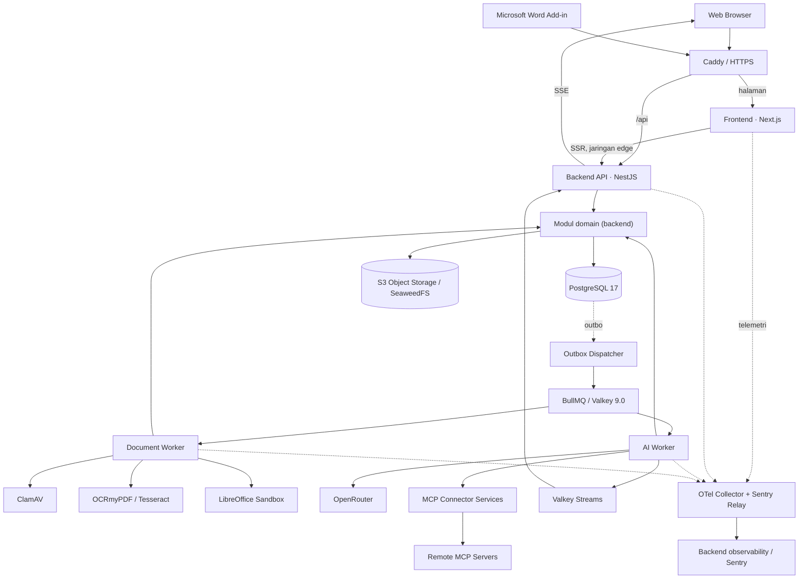

# LEXON
## System Architecture Specification

| Informasi | Detail |
|---|---|
| **Dokumen** | LEX-ARC-001 |
| **Versi** | 1.7 |
| **Status** | **PROPOSED — untuk persetujuan arsitektur** |
| **Tanggal** | 31 Oktober 2026 |
| **Menggantikan** | v1.6 (31 Oktober 2026) |
| **Produk** | Lexon — Indonesian Legal AI Workspace |
| **Acuan teknologi** | [Technology Stack Specification v1.7](./LEXON-01-TECHNOLOGY-STACK.md) · LOCKED (dengan prasyarat validasi) |
| **Acuan desain** | [Design System v1.0](./LEXON-03-DESIGN-SYSTEM.md) |
| **Klasifikasi** | Internal · Product & Engineering |

## 1. Ikhtisar Sistem

Lexon adalah platform kerja hukum berbantuan AI yang memadukan **Chat**, **Tabular Review**, dan **Document Editor** dengan pengelolaan dokumen, project, serta kolaborasi berbasis organisasi. Integrasi layanan eksternal dilakukan melalui konektor berbasis Model Context Protocol (MCP). Arsitektur sistem dirancang untuk menyediakan pengalaman terpadu, pemisahan data yang jelas, dan pemrosesan AI serta dokumen yang dapat berlangsung di luar siklus request pengguna.

Arah pengalaman produk berorientasi pada standar aplikasi legal AI profesional, dengan **Legora dan Harvey** sebagai tolok ukur kategori produk. Arsitektur teknis dalam dokumen ini disusun berdasarkan kebutuhan dan pilihan teknologi Lexon.

**Gaya arsitektur:** frontend dan backend terpisah dalam satu monorepo, dengan struktur folder root yang mengikuti Mike OSS (`backend/`, `frontend/`, `word-add-in/`). Frontend (Next.js) hanya menyajikan antarmuka; seluruh logika bisnis dan akses data berada di backend (NestJS). Di dalam backend, domain tetap berupa modul-modul pada satu codebase yang diakses melalui application services, sedangkan pekerjaan komputasi tertentu dieksekusi oleh worker terpisah yang merupakan entrypoint dari codebase backend yang sama. Rancangan awal dioperasikan pada satu Linux VPS melalui Docker Compose.

**Tiga prinsip penentu:**

1. **Jawaban harus dapat ditelusuri.** Setiap jawaban berbasis dokumen membawa sitasi ke halaman/paragraf sumber yang diverifikasi oleh sistem (§4.3).
2. **Dokumen klien adalah data paling sensitif.** Pengiriman ke model, logging, retensi, dan penghapusan dikendalikan secara eksplisit (§6).
3. **Konten unggahan tidak tepercaya.** File dipindai, diproses dalam batas terisolasi, dan isinya diperlakukan sebagai data, bukan instruksi (§5.2).

**Cakupan bahasa awal (MVP):** Inggris untuk antarmuka, konten, prompt sistem, dan dokumentasi engineering. Bahasa Indonesia disiapkan melalui konfigurasi (§4.3), tanpa perubahan skema.

**Kemampuan produk MVP.** Selain Chat, Tabular Review, dan Document Editor, MVP mencakup: Projects dan Library dokumen, **Workflows** (prosedur kerja AI bertitel yang dapat dipanggil pengguna) beserta **Quick Actions**, **Playbooks** (aturan peninjauan kontrak), **Memory** (preferensi dan fakta tersimpan per pengguna/project yang dipakai ulang AI), **Subagents** (delegasi sub-tugas dari satu run AI), **Riset web** (pencarian web sebagai tool AI dengan sitasi sumber), konektor MCP, serta **ekspor data pribadi**. Di luar cakupan: kunci API milik pengguna (BYOK), aplikasi desktop, dan integrasi basis data putusan pihak ketiga khusus yurisdiksi asing.

## 2. Logical Architecture



*Diagram memperlihatkan dependensi logis utama. Koneksi data, antrean, dan storage dapat digunakan oleh beberapa runtime backend melalui antarmuka infrastruktur yang sama. Frontend tidak memiliki koneksi ke PostgreSQL, Valkey, maupun penyimpanan objek.*

### 2.1 Runtime aplikasi

| Komponen | Fungsi utama | Antarmuka |
|---|---|---|
| **Frontend** | UI dan server-side rendering. Memanggil Backend API (dari browser melalui `/api/*`, dari server Next.js melalui jaringan `edge`). Tanpa akses database, Valkey, atau storage; tanpa rahasia server | HTTPS / Next.js App Router |
| **Backend API** | Seluruh HTTP API, sesi dan autentikasi (Better Auth), validasi, authorization, operasi sinkron, administrasi connector MCP, dan SSE delivery (stream hub) | HTTPS / controller NestJS |
| **AI Worker** | Generation, tool execution, dan pemrosesan pekerjaan AI. Satu-satunya runtime pekerjaan yang berkomunikasi dengan provider model. Entrypoint `backend/` | BullMQ jobs; database dan event streams |
| **Document Worker** | Pemindaian, validasi, ekstraksi, OCR, chunking, dan pemrosesan dokumen. **Tanpa akses internet** karena memproses file tidak tepercaya. Entrypoint `backend/` | BullMQ jobs; database dan object storage |
| **LibreOffice Sandbox** | Konversi format Office dalam lingkungan terisolasi | Layanan internal tanpa akses internet |
| **ClamAV** | Pemindaian malware unggahan | Layanan internal (`clamd`) |
| **Outbox Dispatcher** | Memindahkan entri outbox PostgreSQL ke BullMQ; satu instance aktif (`pg_try_advisory_lock`); dibangunkan `LISTEN/NOTIFY` dengan polling cadangan. Entrypoint `backend/` | PostgreSQL; Valkey |
| **OTel Collector + Sentry Relay** | Satu-satunya jalur ekspor telemetri dan error; penghapusan atribut sensitif lapis kedua; membuat runtime tanpa egress tetap terpantau | OTLP; protokol Sentry |
| **Word Add-in** | Antarmuka Lexon dalam Microsoft Word; bundel statis dari `word-add-in/` yang disajikan Caddy | API Lexon melalui HTTPS (§8) |

**MCP Connector Services** merupakan modul aplikasi yang digunakan oleh Backend API dan AI Worker, bukan runtime deployment tersendiri. Backend API mengelola konfigurasi dan alur otorisasi connector; AI Worker menjalankan tool yang tersedia dalam konteks pekerjaan AI.

Runtime backend (API, AI Worker, Document Worker, Dispatcher) berasal dari satu codebase dan berbagi modul bisnis; tiap entrypoint memiliki root module sendiri yang hanya memuat modul yang dibutuhkannya (§3.6). Pemisahan runtime bertujuan mengisolasi beban kerja dan batas jaringan, bukan membentuk layanan bisnis yang sepenuhnya independen. Pemisahan frontend dari backend adalah batas kepercayaan: frontend tidak pernah menyentuh data atau rahasia server.

### 2.2 Jaringan container

Docker Compose memakai empat jaringan. Jaringan bertanda *internal* tidak memiliki rute keluar; komponen yang memerlukan egress harus tergabung pada jaringan `egress`.

| Jaringan | Anggota | Akses internet |
|---|---|---|
| `edge` | Caddy, Frontend, Backend API, OTel Collector, Sentry Relay | Trafik masuk melalui Caddy |
| `egress` | Backend API, AI Worker, pembaru signature ClamAV (`freshclam`), OTel Collector, Sentry Relay | Satu-satunya jalur keluar. Backend API dan AI Worker memakai klien HTTP yang tervalidasi (§5.1); aturan firewall host membatasi tujuan pembaru signature serta tujuan ekspor Collector dan Relay |
| `core` (internal) | Backend API, AI Worker, Document Worker, Outbox Dispatcher, PostgreSQL, Valkey, penyimpanan objek, OTel Collector, Sentry Relay | Tidak ada |
| `sandbox` (internal) | Document Worker, LibreOffice Sandbox, `clamd` | Tidak ada |

Frontend hanya tergabung pada `edge`: tidak ada rute ke `core` (database, Valkey, penyimpanan), tidak ada egress, dan tidak ada rahasia server. Kompromi pada proses Next.js dengan demikian tidak memberi jalur langsung ke data. Collector dan Relay bergabung ke `edge` hanya untuk menerima telemetri dari Frontend; keduanya tidak menerima koneksi dari luar melalui Caddy.

Document Worker tidak memiliki rute keluar; trace, metrics, dan error-nya dikirim ke OTel Collector dan Sentry Relay pada jaringan `core`, yang meneruskannya ke luar setelah penghapusan atribut. LibreOffice Sandbox dan `clamd` tidak mengirim telemetri langsung; status dan durasinya dilaporkan oleh Document Worker. Telemetri sisi server Next.js dikirim ke Collector dan Relay pada `edge`; error sisi browser dikirim melalui `tunnel` Sentry berupa endpoint Backend API `POST /api/telemetry/sentry-tunnel` yang meneruskannya ke Sentry Relay, dengan pembatasan laju, batas ukuran body, dan allowlist DSN.

## 3. Struktur Aplikasi

### 3.1 Domain dan tanggung jawab

| Domain | Tanggung jawab |
|---|---|
| **Identity & Access** | Identitas, sesi, keanggotaan, role organisasi, dan keputusan izin atas resource |
| **Organizations & Workspaces** | Konteks kerja pengguna, organisasi, keanggotaan, dan pengaturan workspace |
| **Projects** | Pengelompokan pekerjaan (matter), instruksi, relasi percakapan dan dokumen, serta pagar etik (ethical wall) |
| **Chat** | Conversations, messages, AI runs, streaming state, persetujuan tool, riwayat interaksi, dan **subagents** (run anak yang didelegasikan dari run induk, dengan batas kedalaman, anggaran token, dan izin yang tidak melebihi run induk) |
| **Documents** | Upload, metadata, file versions, status pipeline, ekstraksi, OCR, dan lifecycle dokumen |
| **Knowledge & Retrieval** | Chunking, indeks keyword (FTS dan trigram), retrieval, perakitan konteks, dan verifikasi sitasi |
| **Tabular Review** | Review berbasis baris/kolom, sumber dokumen, konfigurasi, status sel, dan hasil analisis |
| **Editor** | Drafting DOCX, versi dokumen, komentar, tracked changes, dan penerapan saran AI |
| **Connectors & MCP** | Koneksi layanan eksternal, kredensial, katalog tool, kebijakan eksekusi, persetujuan tindakan, dan pencatatan hasil tool |
| **Usage & Quotas** | Pencatatan penggunaan model, kuota per organisasi, dan metering biaya |
| **Workflows** | Katalog workflow (bawaan, organisasi, pribadi), Quick Actions, berbagi workflow, dan pemakaian workflow dalam Chat dan Tabular Review |
| **Playbooks** | Aturan peninjauan kontrak (posisi standar, fallback, eskalasi), impor, dan penerapannya pada review dokumen |
| **Memory** | Memori per pengguna dan per project: pembuatan (eksplisit dan usulan AI yang disetujui), lingkup, penyuntingan, penghapusan, dan injeksi ke konteks AI |
| **Research** | Riset web sebagai tool AI: kueri ke penyedia pencarian, pengambilan halaman melalui klien HTTP tervalidasi (§5.1), hasil sebagai data tidak tepercaya beserta sitasi URL |
| **Audit** | Catatan audit append-only atas akses, aksi AI, ekspor, dan perubahan izin; ekspor data pribadi pengguna (§6.3) |
| **Platform Services** | Jobs, notifications operasional, dan observability lintas domain |

Setiap domain adalah satu modul NestJS di `backend/src/modules/<domain>`. Modul memegang aturan bisnis atas resource-nya sendiri dan hanya mengekspor application service yang menjadi kontraknya. Komunikasi lintas modul dilakukan melalui service yang diekspor tersebut; controller HTTP dan processor BullMQ menjadi adaptor eksekusi yang tipis.

### 3.2 Identitas dan otorisasi

**Better Auth** menjadi komponen dasar untuk autentikasi dan manajemen sesi, dipasang di backend (NestJS) pada `/api/auth/*`. Frontend memakai klien `better-auth/react` pada origin yang sama. Body parser bawaan NestJS dinonaktifkan agar Better Auth menangani body mentah, dan parser JSON dipasang untuk rute lain. Adaptor yang dipakai adalah pustaka komunitas `@thallesp/nestjs-better-auth`; adaptor internal tipis di atas `toNodeHandler` hanya dibuat bila S6 menunjukkan ketidakcocokan dengan NestJS 12 atau ESM. Rancangan integrasi memanfaatkan plugin berikut:

- **Organization:** organisasi, anggota, undangan, dan role tingkat organisasi.
- **Admin:** fungsi administratif tingkat platform.
- **Two-Factor:** 2FA; wajib untuk platform administrator dan dapat diwajibkan per organisasi.
- **Bearer:** token untuk klien non-cookie, terutama Word add-in (§8).

Kedua lingkup administrasi dipisahkan:

- **Platform administrator:** mengelola fungsi administratif aplikasi Lexon. Tidak memiliki akses bawaan ke isi dokumen atau percakapan pelanggan (lihat *break-glass*, §6.2).
- **Organization owner/admin/member:** mengelola atau berpartisipasi dalam organisasi yang menjadi lingkupnya.

Izin terhadap **Project, Chat, Document, Tabular Review, dan Editor** diputuskan oleh **Lexon resource-level policies** (guard dan policy services NestJS) berdasarkan identitas, konteks organisasi/project, kepemilikan, dan pemberian akses. Validasi izin dilakukan pada server saat resource dibaca atau diubah, termasuk oleh worker yang memproses pekerjaan terkait. Frontend tidak mengambil keputusan izin; pemeriksaan di antarmuka hanya untuk pengalaman pengguna.

**Isolasi tenant berlapis:**

1. **Lapis aplikasi:** resource-level policies, melalui satu *authorization predicate builder* terpusat. Setiap query yang menyentuh dokumen, chunk, atau percakapan (termasuk keyword search dan retrieval) wajib memakai builder ini; tidak ada jalur query tanpa filter.
2. **Lapis database:** PostgreSQL RLS pada seluruh tabel bertenant (`org_id`) di skema `app` (rincian di bawah).
3. **Pengujian:** uji negatif lintas-tenant dan lintas-project di CI untuk setiap jalur baca (API, worker, retrieval, SSE, ekspor), ditambah uji bahwa query tanpa konteks tenant mengembalikan nol baris.

**Role database dan skema.**

| Role | Dipakai oleh | Hak |
|---|---|---|
| `lexon_migrator` | Drizzle Kit (migrasi) | Pemilik skema `app`, `auth`, dan `ops`; tidak pernah dipakai runtime |
| `lexon_app` | Backend API, AI Worker, Document Worker, Outbox Dispatcher | Tanpa `BYPASSRLS` dan bukan pemilik tabel; DML pada skema `app` (tunduk RLS) dan `ops`; `SELECT` per kolom non-rahasia pada `auth.user`, `auth.organization`, dan `auth.member` untuk keputusan izin |
| `lexon_auth` | Adaptor Better Auth saja | DML hanya pada skema `auth`; tidak memiliki hak atas skema `app` dan `ops` |

Frontend dan Word add-in tidak memiliki role database dan tidak terhubung ke PostgreSQL.

- **Tabel Better Auth** (user, session, account, verification, organization, member, invitation, two-factor) berada di skema `auth` tanpa RLS bertenant, karena Better Auth menjalankan query sendiri tanpa konteks `app.org_id`. Adaptor Better Auth di backend memakai pool koneksi tersendiri dengan role `lexon_auth`. Perlindungannya berupa pemisahan role dan hak per kolom: token sesi, hash password, dan rahasia 2FA tidak dapat dibaca `lexon_app`. Konfigurasi skema pada adapter Drizzle Better Auth diverifikasi saat implementasi.
- **Tabel operasional** tanpa konten klien (outbox, status dispatcher, ledger penghapusan) berada di skema `ops`, hanya memuat id dan metadata (K3, §6.1), dan tidak diberi RLS bertenant agar Outbox Dispatcher dapat bekerja lintas tenant.
- **Wrapper konteks.** Seluruh akses ke skema `app` melewati `withTenant(ctx, fn)` di modul database backend (`backend/src/infrastructure/db`), yang membuka transaksi dan menetapkan `set_config('app.org_id', $1, true)` serta `set_config('app.user_id', $2, true)`. Bentuk `set_config` dipakai karena `SET LOCAL` tidak menerima parameter; argumen `true` membuat nilai berlaku sebatas transaksi sehingga aman bagi connection pool. Konteks (`orgId`, `userId`) diturunkan guard dari sesi Better Auth dan dilewatkan secara eksplisit ke `withTenant`; tidak ada konteks implisit global. Klien database mentah tidak diekspor dari modul tersebut, dan aturan ESLint `no-restricted-imports` melarang impor driver langsung di luar modul itu serta melarang `pg` dan `drizzle-orm` di `frontend/` dan `word-add-in/`.
- **Fail-closed.** Policy RLS berbentuk `org_id = NULLIF(current_setting('app.org_id', true), '')::uuid`. Pada koneksi yang belum pernah menetapkan nilai, `current_setting(..., true)` mengembalikan NULL; pada koneksi pool bekas pakai, setelah transaksi yang memakai `set_config(..., true)` berakhir, nilainya kembali menjadi string kosong, bukan NULL, sehingga cast `::uuid` langsung akan melempar error. `NULLIF` mengubah keduanya menjadi NULL sehingga perbandingan tidak pernah benar dan tidak ada baris yang lolos. Uji wajib (S6): kueri tanpa konteks pada koneksi baru **dan** pada koneksi bekas pakai mengembalikan nol baris tanpa error. Policy dijaga sesederhana perbandingan kesetaraan agar tetap memakai indeks.
- **Worker dan dispatcher** menetapkan konteks dari payload job yang tervalidasi. Pekerjaan lintas tenant (rekonsiliasi, retensi, pemutaran ulang ledger penghapusan) memakai fungsi `SECURITY DEFINER` yang sempit, ber-`search_path` tetap, dan teraudit, bukan role tanpa RLS.

**Ethical wall (pagar etik):** akses ke project/matter berbasis keanggotaan eksplisit. Role organisasi tidak otomatis memberi akses ke isi project (dapat dikonfigurasi per organisasi). Daftar penolakan (*deny list*) per project mengalahkan role mana pun (deny-overrides).

Penggunaan plugin dalam bagian ini merupakan **rincian rancangan integrasi Better Auth**, bukan penetapan teknologi di luar stack yang dikunci.

### 3.3 Integrasi MCP

Lexon menyediakan kemampuan **MCP client** untuk menghubungkan asisten AI dengan tool yang disajikan oleh server MCP jarak jauh. Koneksi dikelola melalui antarmuka **Settings → Connectors** dan diakses melalui layanan aplikasi, dengan dukungan untuk:

- Pendaftaran connector menggunakan URL server yang tervalidasi, daftar connector, pembaruan konfigurasi, penonaktifan, dan penghapusan.
- Autentikasi OAuth 2.0 termasuk proses authorization dan pembaruan token (dengan validasi *issuer* pada metadata OAuth yang ketat, RFC 8414), serta bearer token atau custom headers untuk koneksi yang relevan.
- Discovery dan sinkronisasi metadata tool, skema input, serta pengaturan enabled/disabled per connector dan per tool.
- Kebijakan **read-only** untuk mencegah operasi yang mengubah data dan opsi **persetujuan pengguna sebelum write action** dijalankan.
- Eksekusi tool melalui AI Worker dengan identitas pengguna dan batas akses connector yang diperiksa pada sisi server.
- Pelaporan status, hasil, dan kesalahan pemanggilan tool sebagai bagian dari percakapan AI.

Koneksi dan kredensial terikat pada pemilik serta lingkup aksesnya. Keanggotaan organisasi saja tidak memberikan hak menggunakan koneksi pribadi pengguna lain. Kontrol terhadap koneksi yang dibagikan, jika diaktifkan, harus melalui kebijakan akses yang eksplisit.

### 3.4 Struktur monorepo

Struktur root mengikuti Mike OSS: folder aplikasi berada langsung di root dan tiap aplikasi memiliki `package.json` sendiri. Lexon menamai folder add-in `word-add-in/` (pada repo acuan `word-addin/`). Perbedaan utama dari Mike OSS: pnpm workspace dengan `shared/` sebagai satu-satunya paket bersama, dan backend memiliki empat entrypoint, bukan satu proses.

```text
lexon/
├── backend/                       # NestJS 12 (ESM): API, modul domain, entrypoint worker
│   ├── src/
│   │   ├── entrypoints/           # satu root module + bootstrap per runtime (§3.6)
│   │   │   ├── api/               # Backend API: HTTP + SSE
│   │   │   ├── ai-worker/         # Eksekusi AI jobs
│   │   │   ├── document-worker/   # Scan, OCR, ekstraksi, chunking
│   │   │   └── dispatcher/        # Outbox → BullMQ (satu instance aktif)
│   │   ├── modules/               # Satu modul NestJS per domain (§3.1)
│   │   │   ├── identity-access/
│   │   │   ├── organizations/
│   │   │   ├── projects/
│   │   │   ├── chat/
│   │   │   ├── documents/
│   │   │   ├── knowledge/
│   │   │   ├── tabular-review/
│   │   │   ├── editor/
│   │   │   ├── connectors/
│   │   │   ├── workflows/
│   │   │   ├── playbooks/
│   │   │   ├── memory/
│   │   │   ├── research/
│   │   │   ├── usage/
│   │   │   ├── audit/
│   │   │   └── platform/
│   │   └── infrastructure/
│   │       ├── db/                # Drizzle schema, withTenant, predicate builder, kebijakan RLS
│   │       ├── storage/           # S3 port + enkripsi objek (§5.6)
│   │       ├── queue/             # BullMQ, Valkey, stream hub
│   │       ├── ai/                # AI SDK + OpenRouter, allowlist model/provider
│   │       └── telemetry/         # OpenTelemetry, Sentry
│   ├── drizzle/                   # Migrasi SQL berversi (termasuk RLS dan role)
│   ├── test/
│   ├── Dockerfile                 # target: api, ai-worker, dispatcher, document-worker
│   └── package.json
├── frontend/                      # Next.js 16: UI dan SSR saja
│   ├── src/app/                   # App Router; route groups (auth) dan (workspace)
│   ├── src/components/            # shadcn/ui (Base UI), assistant-ui, editor DOCX, grid Tabular Review
│   ├── src/lib/                   # klien API bertipe, klien Better Auth, ChatTransport
│   ├── Dockerfile
│   └── package.json
├── word-add-in/                   # Office.js + React + Webpack (bundel statis)
├── shared/                        # @lexon/contracts: skema Zod, kontrak event (versioned), antarmuka EditorPort
├── evals/                         # Dataset dan harness evaluasi kualitas AI
├── infra/                         # Deployment produksi: Caddy, sandbox, backup, OTel Collector & Sentry Relay
├── docs/                          # System specifications
├── docker-compose.yml             # Stack pengembangan lokal
├── pnpm-workspace.yaml
└── package.json
```

**Aturan dependensi** (ditegakkan ESLint dan diperiksa di CI):

- `frontend/` dan `word-add-in/` hanya boleh mengimpor `shared/`; keduanya tidak boleh mengimpor `backend/`.
- `backend/` tidak mengimpor `frontend/` maupun `word-add-in/`.
- `shared/` tidak bergantung pada folder lain, hanya memuat tipe, skema, dan antarmuka (tanpa logika bisnis dan tanpa API khusus Node) sehingga dapat dipakai di browser dan add-in.
- Di dalam `backend/`, modul domain lain hanya diimpor melalui barrel publik `index.ts`; driver `pg` dan Drizzle hanya di `infrastructure/db`; AI SDK dan provider hanya melalui `infrastructure/ai`.
- `EditorPort` didefinisikan di `shared/`; adaptor EigenPal berada di `frontend/` (editor di browser) dan di modul `editor` backend (`editor-api`, §4.4).

Pada `frontend/`, Next.js route groups **`(auth)`** dan **`(workspace)`** mengorganisasikan halaman. Logika bisnis ditempatkan pada modul domain backend yang dapat diakses secara konsisten oleh controller dan worker.

Struktur ini adalah organisasi logis tingkat awal; subfolder dibuat sejalan dengan kebutuhan modul.

### 3.5 Batas Frontend–Backend

- **Routing dan origin.** Caddy meneruskan `/api/*` ke Backend API dan seluruh path lain ke Frontend, sehingga browser hanya berhubungan dengan satu origin publik. Cookie sesi Better Auth tidak memerlukan CORS atau pengaturan lintas-subdomain. Pada pengembangan lokal, `rewrites` Next.js meneruskan `/api/*` ke backend.
- **Panggilan dari browser.** Klien Better Auth, klien API bertipe (dari `shared/`), dan `ChatTransport` (§4.1) memanggil `/api/*` langsung, termasuk endpoint SSE. Jalur SSE dilayani Backend API tanpa melewati Next.js.
- **Panggilan dari server Next.js.** Server Components memanggil Backend API melalui `BACKEND_INTERNAL_URL` pada jaringan `edge` dengan meneruskan header `cookie` dari request pengguna. Next.js tidak mengakses database atau storage.
- **Autentikasi di frontend.** `proxy.ts` Next.js 16 (runtime Node.js; pengganti `middleware.ts`) hanya memeriksa keberadaan cookie sesi untuk pengalihan cepat; keputusan akses selalu diambil backend.
- **Larangan.** Route Handlers dan Server Actions tidak dipakai untuk logika bisnis atau akses data; hanya untuk kebutuhan presentasi (misalnya pengalihan atau preferensi tampilan).
- **Kontrak.** Skema request/response dan kontrak event streaming berada di `shared/` (Zod, berversi). Backend memvalidasi masukan dengan skema tersebut pada decorator route (dukungan Standard Schema di NestJS 12; diverifikasi pada S6), dan frontend memakai skema yang sama untuk tipe dan validasi formulir (React Hook Form dengan Zod resolver; data fetching melalui TanStack Query).
- **Kompatibilitas versi.** Word add-in dirilis terpisah dari web dan dapat tertinggal versinya pada klien. Perubahan kontrak API yang tidak kompatibel dikerjakan sebagai versi baru dengan masa transisi.
- **CORS.** Hanya origin Word add-in (pada `/api/*`) dan host data-plane S3 (§5.1) yang memerlukan CORS; tidak ada CORS untuk frontend utama.

### 3.6 Entrypoint backend dan komposisi modul

Backend dibangun dari satu codebase dan dijalankan sebagai empat proses. Tiap entrypoint memiliki root module sendiri; worker dan dispatcher memakai *application context* NestJS (tanpa listener HTTP).

| Entrypoint | Memuat | Sengaja tidak memuat |
|---|---|---|
| `api` | Seluruh modul domain, controller, Better Auth, stream hub; antrean hanya sebagai *producer* | Processor BullMQ |
| `ai-worker` | Chat (termasuk subagents), Knowledge & Retrieval (retrieval), Tabular Review, Connectors (eksekusi tool), Workflows dan Playbooks (baca), Memory, Research, Usage, Audit; processor `ai-*` | Controller HTTP, Better Auth |
| `document-worker` | Documents, Knowledge & Retrieval (chunking), ekspor XLSX; processor `doc-*` | `infrastructure/ai` (klien model), Better Auth, controller HTTP |
| `dispatcher` | Platform Services (outbox) | Modul domain lain |

Dengan demikian pembatasan Document Worker (tanpa internet, tanpa provider model) ditegakkan dua kali: pada jaringan container (§2.2) dan pada komposisi modul. Satu `Dockerfile` backend memiliki target `api`, `ai-worker`, `dispatcher`, dan `document-worker`; target `document-worker` menambahkan toolchain OCR (OCRmyPDF, Tesseract) dan pustaka pendukungnya.

## 4. Data & Integration Architecture

| Komponen | Data/operasi yang menjadi tanggung jawabnya |
|---|---|
| **PostgreSQL** | User/resource references, organisasi, izin, conversations, metadata dan versions, chunk, review state, usage events, audit log, durable job state |
| **Object storage (S3 / SeaweedFS)** | Objek file, dokumen sumber, hasil OCR, dan artifacts dokumen; konten area aktif terenkripsi aplikasi per organisasi (§5.6) |
| **Valkey / BullMQ** | Antrean pekerjaan, scheduling, dispatch, retry, rate limiting, dan koordinasi proses |
| **Valkey Streams** | Pengiriman event antar-runtime untuk streaming real-time |
| **SSE** | Koneksi pengiriman event dari Backend API ke klien |
| **OpenRouter** | Gateway model AI yang dipanggil oleh AI Worker (dengan kebijakan retensi nol, §6.2) |
| **MCP connector services** | Identitas connector, konfigurasi otorisasi terenkripsi, katalog tool, policy, dan status persetujuan tersimpan di PostgreSQL |
| **Remote MCP servers** | Menyediakan tool eksternal yang dipanggil oleh AI Worker melalui transport Streamable HTTP |

**Aturan data utama:** PostgreSQL menyimpan state bisnis yang otoritatif; objek biner berada di penyimpanan S3. Identitas dan izin file ditentukan oleh metadata serta kebijakan aplikasi. Event real-time dan antrean bukan pengganti catatan bisnis permanen. Penyimpanan objek diakses hanya melalui **S3 port** di `backend/src/infrastructure/storage` dan diuji dengan contract test sehingga implementasinya dapat diganti. Enkripsi dan dekripsi objek (§5.6) berlangsung di lapisan port ini, sehingga implementasi penyimpanan hanya melihat ciphertext.

### 4.1 Alur Chat dan kontrak streaming

**Kontrak streaming (rancangan; divalidasi pada spike S2):**

1. **Kirim prompt.** Klien memanggil API terautentikasi. API memvalidasi input dan izin, lalu dalam satu transaksi menyimpan message, membuat `ai_run` berstatus `queued`, dan mencatat entri outbox. Respons memuat `runId`.
2. **Dispatch.** Outbox Dispatcher (§2.1) dibangunkan oleh `NOTIFY` dari transaksi pengirim (dengan polling cadangan), mengambil entri dengan `FOR UPDATE SKIP LOCKED`, dan meneruskannya ke BullMQ dengan job id = id outbox sehingga pengiriman ulang bersifat idempotent. Bila Valkey menolak tulis atau tidak tersedia, entri tetap di outbox dan dicoba ulang dengan backoff; tidak ada pekerjaan yang hilang.
3. **Eksekusi.** AI Worker menjalankan generation melalui AI SDK/OpenRouter dan menulis setiap potongan ke Valkey Stream `run:{runId}` (`XADD` dengan `MAXLEN`). Format potongan mengikuti protokol UI message stream AI SDK agar dapat dikonsumsi `useChat`/assistant-ui; skema dan versi event didefinisikan di `shared/`.
4. **Pengiriman ke klien.** Endpoint SSE `GET /api/runs/{runId}/events` pada Backend API memverifikasi izin, lalu berlangganan ke **stream hub** milik proses Backend API tersebut. Setiap proses Backend API menjalankan satu hub dengan satu koneksi Valkey khusus yang membaca seluruh stream aktif sekaligus (`XREAD BLOCK` multi-key dengan blok pendek, usulan 1–2 detik, agar daftar stream diperbarui saat ada pelanggan baru), lalu mem-*fan-out* frame ke pelanggan di memori. Jumlah koneksi Valkey per proses tetap dan tidak bertambah per klien. Replay `Last-Event-ID` dilakukan dengan `XRANGE` melalui koneksi non-blocking bersama sebelum pelanggan bergabung ke hub; frame dideduplikasi berdasarkan id entri sehingga peralihan replay → live tidak menghilangkan atau menggandakan frame. Frame diteruskan dengan `id` = id entri stream, ditambah *heartbeat* berkala. Jumlah koneksi SSE per pengguna dibatasi. Caddy dikonfigurasi tanpa buffering dan dengan timeout baca panjang untuk jalur ini. Jalur ini dilayani langsung oleh Backend API (tidak melalui Next.js), sehingga umur koneksi SSE tidak membebani proses frontend. Saat Backend API berhenti untuk deploy, hub menutup koneksi SSE secara terkontrol agar klien menyambung ulang dengan `Last-Event-ID` ke instance baru; dukungan graceful shutdown adaptor Express NestJS 12 dipakai bila tersedia dan diverifikasi pada S2.
5. **Checkpoint dan penyelesaian.** Worker menyimpan checkpoint pesan parsial ke PostgreSQL pada batas langkah (dan periodik selama generation panjang). Pada akhir, pesan final, penggunaan token/biaya, dan status `completed` ditulis dalam satu transaksi, lalu event `finish` diterbitkan dan stream diberi TTL pendek.
6. **Reconnect/resume.** Klien yang membuka ulang conversation dengan run aktif menyambung ke endpoint yang sama menggunakan `Last-Event-ID`. Bila stream telah kedaluwarsa, klien memuat pesan dari PostgreSQL (final atau checkpoint terakhir dengan status run).
7. **Cancel.** `POST /api/runs/{runId}/cancel` menetapkan status `cancelling` dan menerbitkan sinyal kontrol; worker menghentikan generation melalui `AbortSignal`, menyimpan hasil parsial, dan menetapkan `cancelled`.
8. **Persetujuan tool (write action).** Saat tool memerlukan persetujuan, worker menyimpan operasi beserta *hash snapshot*-nya, menetapkan run `awaiting_approval`, menerbitkan event, lalu **mengakhiri job** (slot worker dibebaskan). Keputusan pengguna diterima API, divalidasi (pemilik, hash snapshot, izin, status connector), kemudian job `resume` dikirim melalui outbox. Persetujuan yang tidak dijawab kedaluwarsa menjadi penolakan.
9. **Kegagalan worker.** Job yang *stalled* dicoba ulang dengan id yang sama dan dilanjutkan dari checkpoint terakhir; klien menerima event `reset` untuk pesan yang sedang berjalan agar potongan parsial dibuang.

**Integrasi klien:** transport `ChatTransport` kustom di `frontend/src/lib` — pengiriman prompt ke endpoint run dan penyambungan ulang ke endpoint SSE — dihubungkan ke assistant-ui. Kecocokan dengan AI SDK 7 / `@ai-sdk/react` 4 divalidasi pada spike S2.

**Sifat rancangan:** generation tidak bergantung pada umur koneksi browser. Retry dan pemrosesan berulang ditangani dengan identitas job/run serta operasi persistensi yang idempotent. Jaminan replay dan recovery ditentukan oleh state tersimpan dan retensi event yang dikonfigurasi.

### 4.2 Alur Dokumen (upload hingga terindeks)

1. Pengguna meminta upload melalui API Lexon.
2. API memvalidasi konteks, izin, ukuran, dan tipe, lalu menerbitkan presigned URL menggunakan AWS SDK v3 ke area *quarantine* (prefiks objek terpisah).
3. Klien mengunggah objek ke endpoint penyimpanan melalui HTTPS.
4. Backend memverifikasi objek (ukuran, checksum, *magic bytes* — bukan hanya ekstensi) dan mencatat metadata serta versi dokumen di PostgreSQL dengan status `uploaded`.
5. Document Worker menjalankan pipeline berikut. Setiap tahap idempotent per versi dokumen dan mencatat statusnya:

| Status | Tahap | Keterangan |
|---|---|---|
| `scanning` | Pemindaian ClamAV | Hasil positif → `quarantined`; objek tidak diproses dan tidak dapat diunduh |
| `validating` | Validasi struktur | Rasio kompresi dan ukuran terurai untuk OOXML/ZIP; parser XML tanpa entitas eksternal; batas jumlah halaman |
| `converting` | Konversi (bila perlu) | Format Office legacy dikonversi melalui LibreOffice Sandbox |
| `extracting` | Ekstraksi teks | PDF.js (teks beserta posisi) dan Mammoth/parser DOCX |
| `ocr` | OCR (bila perlu) | Halaman tanpa text layer yang memadai diproses OCRmyPDF/Tesseract; hasil disimpan sebagai artefak PDF dengan text layer, sedangkan **file asli tidak diubah** |
| `chunking` | Pembagian chunk | Berbasis struktur, membawa jangkar sitasi (§4.3); kolom `tsvector` dan indeks trigram terisi saat chunk ditulis |
| `indexed` | Siap | Tersedia bagi Chat, Tabular Review, dan Editor |
| `failed` | Gagal | Dengan kode alasan; dapat dicoba ulang |

6. Objek dipindahkan dari area quarantine ke area aktif hanya setelah lolos pemindaian dan validasi; saat dipindahkan, objek dienkripsi dengan DEK organisasi (§5.6). Objek di quarantine tidak terenkripsi aplikasi dan berumur pendek (lifecycle kedaluwarsa, usulan 24 jam).

**OCR (v1: bahasa Inggris).** Klasifikasi per halaman: halaman dengan cakupan teks rendah dikirim ke OCR. Gambar (PNG/JPG/TIFF) dikonversi menjadi PDF lalu di-OCR. Bahasa OCR ditentukan konfigurasi (`OCR_LANGS=eng`); bahasa Indonesia ditambahkan dengan menambah paket bahasa Tesseract (`eng+ind`) tanpa perubahan kode. Skor kepercayaan OCR disimpan per halaman; halaman berkepercayaan rendah ditandai di UI dan pada sitasi. OCR berjalan lokal agar isi dokumen tidak dikirim ke pihak ketiga.

**Bahasa dokumen.** Ekstraksi dan OCR tidak bergantung pada konfigurasi bahasa PostgreSQL; keduanya terpisah dari pencarian (§4.3). Bahasa terdeteksi per versi dokumen dan disimpan sebagai metadata.

Metadata database dan operasi object storage dapat selesai pada waktu berbeda; proses penyelesaian, retry, dan cleanup harus menjaga konsistensi lifecycle dokumen. Unggahan yatim (objek tanpa catatan) dibersihkan oleh *lifecycle rule* dan job rekonsiliasi.

### 4.3 Retrieval & Grounding

**Pipeline retrieval:**

1. **Chunking berbasis struktur.** Teks dipecah mengikuti struktur dokumen (heading, pasal/klausul, paragraf, tabel) dengan ukuran target dan tumpang tindih yang dikonfigurasi. Setiap chunk membawa jangkar sitasi: id versi dokumen, halaman awal/akhir, offset karakter, dan untuk PDF kotak pembatas (*bounding boxes*) dari posisi teks PDF.js; untuk DOCX, indeks paragraf dan offset.
2. **Indeks.** Setiap chunk menyimpan: `tsvector` (dihasilkan dari konfigurasi bahasa chunk), teks untuk trigram, dan `org_id` yang didenormalisasi untuk filter tenant dan RLS. Indeks: GIN pada `tsvector`, GIN `pg_trgm` pada teks chunk, dan B-tree `(org_id, document_version_id)`.
3. **Retrieval keyword.** Kueri dijalankan sebagai keyword search (FTS) dan, untuk pola sitasi atau nomor pasal, trigram. Hasil digabung dengan *Reciprocal Rank Fusion* di SQL. Semua kueri memakai authorization predicate builder (§3.2) dan filter project/dokumen yang dipilih pengguna; filter berada pada kueri yang sama dengan pencarian indeks, bukan sesudahnya.
4. **Reranking (opsional).** Pengurutan ulang oleh model; diaktifkan hanya bila evaluasi menunjukkan manfaat sepadan dengan biaya dan latensi.
5. **Perakitan konteks.** Dua jalur: **konteks penuh** untuk dokumen tunggal yang muat dalam anggaran token model (umum untuk kontrak), dan **retrieval** untuk banyak dokumen atau dokumen sangat panjang. Pemilihan dilakukan per permintaan berdasarkan anggaran token.
6. **Generasi dengan sitasi terstruktur.** Model diminta mengeluarkan sitasi sebagai data terstruktur (id chunk + kutipan pendek).
7. **Verifikasi sitasi.** Server memeriksa bahwa setiap kutipan benar-benar terdapat (setelah normalisasi) pada chunk yang dirujuk. Sitasi yang gagal diverifikasi ditandai "tidak terverifikasi" di UI dan dicatat untuk evaluasi. Klik sitasi membuka sumber pada halaman/paragraf terkait (PDF.js atau editor DOCX).

**Pencarian semantik (vektor) tidak dipakai di MVP.** Skala MVP (puluhan dokumen per project) dilayani oleh jalur konteks penuh untuk dokumen tunggal dan FTS + trigram untuk banyak dokumen. Tidak ada embedding, kolom vektor, maupun ekstensi `pgvector`. Konsekuensi yang diterima: pertanyaan yang diparafrasekan jauh dari kata kunci dokumen lebih bergantung pada konteks penuh dan kualitas FTS. Pencarian vektor ditambahkan kemudian hanya melalui perubahan stack yang eksplisit (ekstensi, tabel vektor terpisah, job embedding), bila evaluasi (§7.2) menunjukkan Recall@K FTS di bawah ambang yang disepakati atau korpus per organisasi tumbuh melampaui yang dapat dilayani FTS. Rancangan tidak menutup jalur ini: chunk, jangkar sitasi, dan filter otorisasi tidak bergantung pada vektor.

**Konfigurasi bahasa pencarian.**

| Aspek | v1 (Inggris) | Penambahan Indonesia |
|---|---|---|
| Konfigurasi FTS | `english` | `indonesian` (stemmer Snowball bawaan PostgreSQL), dengan daftar stopword dan dictionary sinonim untuk singkatan hukum (UU, PP, Perpres, KUHPer, dst.) |
| Skema | Kolom `search_config` per chunk | Tidak berubah |
| Perubahan yang diperlukan | — | Perubahan konfigurasi dan re-index chunk; OCR menambah `ind` |
| Dokumen dua bahasa | — | Indeks per chunk sesuai bahasa terdeteksi; kueri dijalankan pada kedua konfigurasi |

Stemmer Snowball bersifat sederhana (menangani prefiks/sufiks umum) sehingga kualitasnya diukur melalui evaluasi (§7) sebelum dianggap memadai; bila tidak memadai, perbaikan ditempuh melalui dictionary sinonim, trigram, dan reranking opsional sebelum pencarian vektor dipertimbangkan. Peringkat FTS PostgreSQL (`ts_rank`) bukan BM25; bila evaluasi menunjukkan kekurangan, alternatif dievaluasi melalui perubahan stack yang eksplisit.

**Korpus hukum bersama** (peraturan perundang-undangan, putusan) di luar cakupan MVP (v1.3): dapat disediakan melalui konektor MCP atau korpus internal yang memakai skema chunk yang sama dengan lingkup `global` (keputusan terbuka, §9).

### 4.4 Editor dan format kanonik dokumen

- **DOCX adalah format kanonik** seluruh dokumen hukum. Tracked changes dan komentar disimpan di dalam OOXML (`w:ins`, `w:del`, `comments.xml`); tabel di PostgreSQL hanya memuat indeks turunan untuk daftar dan pencarian.
- **Peran editor.** EigenPal (Core + Pro) menyunting DOCX di browser. Tiptap hanya untuk konten non-DOCX (instruksi project, composer, catatan, pratinjau draf AI) dan tidak menjadi sumber kebenaran dokumen hukum.
- **`EditorPort`.** Domain Editor berinteraksi dengan editor melalui antarmuka internal (open, save, applySuggestions, listChanges, export) sehingga penggantian editor tidak mengubah domain. Antarmuka didefinisikan di `shared/`; adaptor EigenPal berada di `frontend/` (editor di browser) dan di modul `editor` backend (`editor-api`, untuk pembuatan OOXML di server, lihat *Saran AI* dan §8).
- **Versi dokumen.** Setiap versi tidak dapat diubah (`document_versions`: checksum, kunci objek, ukuran, pembuat, asal [`upload` | `user_edit` | `ai_edit`], versi induk). *Autosave* menimpa draf kerja per pengguna; versi baru dibuat pada simpan eksplisit, penerapan saran AI, dan penutupan sesi.
- **Saran AI.** Perubahan yang diusulkan AI diterapkan sebagai **tracked changes** dengan penulis "Lexon AI (atas nama pengguna)" sehingga pengguna menerima atau menolak satu per satu. Penerapan di klien atau server (editor-api) ditentukan pada spike S1.
- **Konkurensi (v1).** Satu penyunting aktif per dokumen melalui kunci lunak (*soft lock*) dengan indikator kehadiran; penyimpanan menggunakan `base_version_id` (optimistic) dan konflik ditangani dengan membuat cabang untuk digabung manual. **Kolaborasi real-time bukan target v1.**
- **Ekspor.** DOCX asli dan PDF (melalui LibreOffice Sandbox).

### 4.5 Tabular Review

- **Model data:** `review` → kolom (pertanyaan, tipe/skema keluaran) × baris (versi dokumen) → `cell` (nilai, status, sitasi, run, model, token).
- **Status sel:** `pending` → `running` → `done` | `error` | `stale` (stale bila dokumen atau pertanyaan berubah).
- **Unit kerja default: satu panggilan per dokumen.** Seluruh kolom untuk satu baris diminta dalam satu panggilan dengan structured output (skema gabungan dari skema keluaran tiap kolom, divalidasi Zod). Review 50 dokumen × 20 kolom menjadi ±50 panggilan, bukan 1.000. Kolom dipecah ke beberapa panggilan bila jumlah kolom atau ukuran skema melampaui ambang terkonfigurasi, bila kolom memerlukan model berbeda, atau bila dokumen melebihi anggaran token (kolom tersebut memakai jalur retrieval §4.3).
- **Pemakaian ulang konteks:** prompt disusun dengan prefiks stabil (instruksi → dokumen → pertanyaan kolom) agar prompt caching provider terpakai bila didukung; token yang terbaca dari cache dicatat di `usage_events`.
- **Granularitas pengulangan:** retry dan re-run berlaku per sel. Sel `error` dan `stale` dikerjakan ulang tanpa mengulang sel `done`; perubahan satu kolom memicu satu panggilan per dokumen untuk kolom itu saja.
- **Sitasi per sel** diverifikasi dengan mekanisme yang sama dengan Chat (§4.3 langkah 7).
- **Penjadwalan:** job per dokumen dikirim ke AI Worker (antrean `ai-batch`) dengan batas concurrency per organisasi (§5.3) dan prioritas lebih rendah daripada Chat interaktif; estimasi biaya ditampilkan sebelum run dimulai (§7.3).
- **Pengiriman hasil:** pembaruan sel diteruskan ke grid melalui stream `review:{id}` (mekanisme sama dengan §4.1).
- **Antarmuka:** TanStack Table dengan virtualisasi; edit manual oleh pengguna dicatat dan tidak ditimpa ulang tanpa konfirmasi.
- **Ekspor:** XLSX melalui ExcelJS di Document Worker untuk review besar.
- Pekerjaan analisis dijadwalkan ke worker terkait; konfigurasi dan status baris/kolom dikelola secara transaksional.

### 4.6 Alur Koneksi dan Tool MCP

1. Pengguna menambahkan connector pada pengaturan akun. API memvalidasi URL tujuan, konteks akses, dan metode otorisasi yang dipilih.
2. Pada koneksi OAuth, API menjalankan alur otorisasi melalui callback HTTPS dan menyimpan token secara terenkripsi (§5.6). Pada koneksi berbasis bearer token atau headers, kredensial juga dikelola oleh server.
3. Connector services memakai klien MCP `@modelcontextprotocol/client` v2 (spec 2026-07-28; peer dependency Zod 4) yang diuji juga terhadap server berspec lama. Pemakaian klien ini tidak mengubah kontrak SSE Lexon sendiri (§4.1). Connector services mengambil katalog tool dari server MCP, memvalidasi dan menyimpan metadata yang dibutuhkan, serta menerapkan status dan kebijakan tiap tool.
4. Saat AI membutuhkan tool, AI Worker memeriksa identitas pemanggil, kepemilikan connector, status koneksi, skema argumen, izin, dan klasifikasi read/write.
5. Tindakan yang mewajibkan persetujuan ditahan hingga pengguna menyetujuinya (§4.1 langkah 8). Keputusan diterapkan terhadap operasi yang tersimpan pada server; izin dan konfigurasi connector diperiksa kembali sebelum eksekusi.
6. Hasil eksekusi diteruskan ke AI sebagai **data eksternal yang tidak tepercaya**, dengan batas waktu, pembatasan ukuran, penanganan kegagalan, dan audit yang sesuai.

**Batas konsistensi:** persetujuan hanya berlaku untuk operasi dan konteks yang dinyatakan, tidak otomatis dapat digunakan ulang untuk server, akun, atau kredensial yang telah berubah. Permintaan yang gagal karena otorisasi atau koneksi tidak boleh diam-diam dieksekusi dengan identitas lain.

### 4.7 AI Run Engine

Seluruh pekerjaan AI interaktif dan batch (Chat, chat dalam project, chat atas Tabular Review, chat di Word add-in, subagents, serta eksekusi Workflows dan Playbooks) dijalankan oleh **satu mesin run** di AI Worker. Mesin ini tidak mengenal fitur; fitur menyambung melalui kontrak yang ditetapkan, sehingga penambahan fitur tidak mengubah mesin.

**Tanggung jawab mesin:** state machine `ai_run` (`queued` → `running` → `awaiting_approval` → `completed` | `failed` | `cancelling` → `cancelled`), pemrosesan job dari antrean `ai-*`, loop model–tool dengan batas iterasi dan anggaran token, pemanggilan model hanya melalui `infrastructure/ai` (allowlist dan preferensi provider, §6.2), penulisan event ke Valkey Streams sesuai kontrak `shared/` (§4.1 langkah 3), checkpoint pada batas langkah, cancel melalui `AbortSignal`, jeda persetujuan dan kelanjutan melalui job `resume` (§4.1 langkah 8), pencatatan `usage_events`, serta tracing tanpa isi K1 (§7.1).

**Titik sambung (extension points):**

| Kontrak | Fungsi | Contoh penyedia |
|---|---|---|
| **Run profile** | Konfigurasi per jenis permukaan: model default dan yang diizinkan, batas iterasi, anggaran token, prioritas antrean, serta kapabilitas yang boleh diaktifkan | chat, project chat, tabular chat, Word chat, subagent, workflow |
| **Context provider** | Menyumbang bagian konteks prompt dengan anggaran token sendiri; setiap isi yang berasal dari dokumen, memory, web, atau tool ditempatkan sebagai **data terdelimitasi yang tidak tepercaya** (§5.1 *Prompt injection*) | dokumen dan chunk (§4.3), instruksi project, memory, workflow, playbook |
| **Tool provider** | Mendaftarkan tool beserta skema argumen (Zod), klasifikasi read/write, kebutuhan persetujuan, batas waktu, dan batas ukuran hasil | retrieval, riset web, konektor MCP (§4.6), edit dokumen (§4.4), subagent, tool klien Word (§8) |
| **Capability policy** | Menentukan kapabilitas dan tool yang aktif untuk satu run berdasarkan identitas, konteks organisasi/project, dan izin atas resource (§3.2) yang diperiksa di server; bukan berdasarkan flag yang dikirim pemanggil | seluruh permukaan |

**Aturan:**

- Fitur menambah perilaku dengan mendaftarkan run profile, context provider, atau tool provider; **tidak** dengan menambah parameter atau percabangan di dalam mesin.
- Izin dihitung ulang oleh capability policy setiap kali run dimulai atau dilanjutkan; tool write tanpa izin tidak diiklankan ke model dan tetap ditolak bila diminta.
- Subagent adalah run anak dengan run profile sendiri; kapabilitasnya merupakan irisan dari kapabilitas run induk dan dibatasi kedalaman serta anggaran.
- Mesin dapat diuji tanpa HTTP dan tanpa jaringan memakai model tiruan; runner `evals/` (§7.2) memakai mesin yang sama.

## 5. Deployment, Isolasi & Ketahanan

### 5.1 Topologi dan batas keamanan

Topologi deployment awal menggunakan Docker Compose di Linux VPS dengan komponen Caddy, Frontend, Backend API, AI Worker, Document Worker, Outbox Dispatcher, LibreOffice Sandbox, ClamAV, PostgreSQL, Valkey, dan penyimpanan objek S3. Word add-in disajikan sebagai bundel statis oleh Caddy dan mengakses API Lexon melalui HTTPS.

- **Ingress:** Caddy menangani HTTPS dan routing trafik publik: `/api/*` ke Backend API, path lain ke Frontend, dan bundel add-in pada host tersendiri.
- **Frontend:** hanya pada jaringan `edge`, tanpa akses data dan tanpa rahasia server (§2.2, §3.5).
- **Private network:** koneksi database, queue, worker, dan endpoint administratif storage berada dalam jaringan internal deployment (§2.2).
- **Object transfer:** upload memakai presigned URL dengan masa berlaku singkat, scope objek, dan pembatasan ukuran. Hanya endpoint S3 *data-plane* yang diekspos melalui Caddy pada host terpisah dengan CORS terbatas; endpoint master, filer, dan administratif tetap internal. Unduhan dan tampilan dokumen dilayani melalui endpoint Backend API yang mendekripsi secara streaming dengan dukungan `Range` (§5.6), bukan presigned GET langsung ke penyimpanan.
- **Application authorization:** setiap operasi resource melewati validasi izin server-side dan RLS (§3.2).
- **Rate limiting:** limiter berbasis Valkey pada endpoint autentikasi, unggah, dan AI; batas per pengguna dan per organisasi.
- **MCP outbound security:** tujuan HTTP divalidasi untuk mencegah SSRF; alamat privat, *link-local*, dan metadata cloud diblokir; DNS diselesaikan sekali dan koneksi dipin ke IP yang telah divalidasi (anti *DNS rebinding*); perubahan tujuan akibat redirect tidak boleh melewati kebijakan; setiap koneksi memiliki timeout dan batas ukuran respons.
- **MCP credential protection:** token dan header rahasia dienkripsi saat disimpan (§5.6); kredensial serta isi dokumen tidak dimasukkan ke log diagnostik umum.
- **MCP tool authorization:** operasi dieksekusi dalam konteks pemilik connector, di bawah kebijakan per tool; tindakan write dengan persetujuan memerlukan validasi ulang tepat sebelum eksekusi.
- **Prompt injection:** isi dokumen, halaman web, dan hasil tool selalu ditempatkan sebagai data terdelimitasi dalam prompt; instruksi di dalamnya tidak pernah memicu tool write tanpa persetujuan pengguna; AI tidak mengikuti URL secara otomatis. Himpunan uji injeksi menjadi bagian evaluasi (§7).
- **Operations:** error dicatat melalui Sentry (scrubbing di SDK) dan diteruskan lewat Sentry Relay; tracing/metrics menggunakan OpenTelemetry dan diekspor hanya melalui OTel Collector, yang membuang atribut di luar daftar izin sebagai lapis kedua; pengujian serta build otomatis menggunakan GitHub Actions.

### 5.2 Isolasi eksekusi file tidak tepercaya

| Komponen | Kontrol |
|---|---|
| **LibreOffice Sandbox** | Container terpisah pada jaringan tanpa egress; pengguna non-root; *root filesystem* read-only dengan `tmpfs` kerja; `cap_drop: ALL`; profil pengguna LibreOffice terpisah per konversi (`-env:UserInstallation`); batas waktu dan memori dengan penghentian paksa; maksimal 1–2 konversi bersamaan |
| **OCR** | Proses anak dengan batas waktu, memori, dan jumlah halaman; antrean tersendiri dengan concurrency 1–2 |
| **ClamAV** | `clamd` pada jaringan sandbox tanpa egress; signature diperbarui terjadwal oleh kontainer `freshclam` terpisah (jaringan `egress`) melalui volume bersama; objek yang belum dipindai tidak dapat diunduh atau diproses |
| **Parser dokumen** | Entitas XML eksternal dinonaktifkan; batas rasio kompresi dan ukuran terurai; batas kedalaman struktur |
| **Hasil unduhan** | Disajikan dengan `Content-Disposition` dan `Content-Type` yang tepat, tanpa eksekusi konten aktif |

### 5.3 Anggaran sumber daya dan keadilan antar-tenant

- Setiap layanan memiliki batas memori dan CPU di Compose; profil awal dikalibrasi melalui uji beban sebelum produksi.
- Antrean dipisah per jenis pekerjaan (`ai-interactive`, `ai-batch`, `doc-scan`, `doc-ocr`, `doc-chunk`, `doc-convert`) dengan concurrency masing-masing; Chat interaktif diprioritaskan di atas Tabular Review dan indexing.
- Pembatasan concurrency per organisasi diterapkan di aplikasi (token bucket di Valkey) agar satu organisasi tidak menguras antrean.
- Kapasitas PostgreSQL dilindungi dengan pool koneksi terbatas per runtime dan `statement_timeout`.

**Profil sumber daya awal** (titik awal; dikalibrasi melalui uji beban sebelum produksi):

| Layanan | Batas memori | CPU | Catatan |
|---|---|---|---|
| PostgreSQL 17 | 4 GB | 2 | `shared_buffers` ±1 GB; indeks GIN (FTS dan trigram) sebaiknya muat di memori |
| Valkey 9.0.x | 1 GB (`maxmemory` 768 MB) | 0,5 | Anggaran per penggunaan §5.4 |
| SeaweedFS (master, volume, filer, S3) | 1 GB | 0,5 | |
| Backend API (NestJS) | 1,5 GB | 1 | Termasuk stream hub |
| Frontend (Next.js) | 0,75 GB | 0,5 | SSR saja; tanpa koneksi SSE dan tanpa akses data |
| AI Worker | 1 GB | 1 | Dominan I/O jaringan |
| Outbox Dispatcher | 256 MB | 0,25 | |
| Document Worker (termasuk OCR) | 3 GB | 2 | OCR dominan CPU; concurrency 1–2 |
| LibreOffice Sandbox | 2 GB | 1 | 1–2 konversi bersamaan |
| `clamd` | 3 GB | 1 | Basis signature membutuhkan memori dalam orde 1 GB lebih dan dapat berlipat saat reload |
| Caddy, `freshclam`, OTel Collector, Sentry Relay | 1 GB total | 0,5 | |
| **Total** | **±18,5 GB** | **±10 (CPU boleh overcommit)** | |

- **Produksi/pilot:** minimum 8 vCPU, 32 GB RAM, NVMe; sisa memori dipakai sebagai page cache sistem berkas untuk PostgreSQL dan SeaweedFS.
- **Staging/pengembangan:** 16 GB memadai dengan batas diturunkan dan `ConcurrentDatabaseReload no` pada `clamd` (memori tidak berlipat saat reload signature; pemindaian berhenti sesaat, dapat diterima karena pemindaian berjalan asinkron).
- **Overhead NestJS:** setiap proses backend memuat runtime NestJS dan kontainer dependency injection, sehingga batas AI Worker, Dispatcher, dan Document Worker (terutama Dispatcher) dikalibrasi ulang pada uji beban.

### 5.4 Valkey

- Satu instance Valkey 9.0.x (patch ≥ 9.0.6, di-pin) untuk BullMQ, Streams, dan rate limiting, dengan autentikasi dan hanya pada jaringan internal. Aplikasi memakai konfigurasi koneksi terpisah per penggunaan (`VALKEY_QUEUE_URL`, `VALKEY_STREAMS_URL`, `VALKEY_LIMITER_URL`) yang saat ini menunjuk instance yang sama, sehingga pemisahan ke instance lain cukup berupa perubahan konfigurasi.
- `maxmemory-policy noeviction` (wajib bagi BullMQ); AOF `everysec`; alarm pada 70% `maxmemory`. Perilaku `noeviction` dan AOF diuji ulang pada Valkey 9.0.x di S6.
- **Anggaran memori per penggunaan** (awal): BullMQ ≤ 50%, Streams ≤ 30%, rate limiter ≤ 10%, cadangan 10%. Anggaran ditegakkan melalui batas yang dapat dihitung: `MAXLEN` per stream × batas run aktif (per organisasi dan global); TTL pada seluruh kunci limiter; `removeOnComplete`/`removeOnFail` berbasis usia dan jumlah. Kunci memakai prefiks per penggunaan (`bull:`, `run:`/`review:`, `rl:`), dan pemakaian per prefiks dipantau melalui sampling `MEMORY USAGE` berkala.
- **Perilaku saat Valkey penuh atau tidak tersedia:** enqueue gagal tetapi entri tetap di outbox (§4.1 langkah 2); streaming jatuh ke pemuatan dari PostgreSQL (checkpoint); rate limiter *fail-closed* untuk endpoint autentikasi dan *fail-open* dengan batas lokal per proses untuk endpoint lain; kuota biaya tetap ditegakkan dari `usage_events` di PostgreSQL.
- Pemisahan instance (antrean terpisah dari streams + limiter) dilakukan bila alarm memori berulang atau satu penggunaan konsisten melampaui anggarannya.
- Valkey bukan sumber kebenaran: kehilangan data Valkey dipulihkan dari outbox dan status di PostgreSQL.

### 5.5 Backup dan pemulihan

| Data | Mekanisme | Target awal (usulan; disetujui bisnis) |
|---|---|---|
| PostgreSQL | pgBackRest: backup penuh berkala + arsip WAL, terenkripsi, ke penyimpanan off-site; retensi dibatasi jendela W | RPO ≤ 15 menit |
| Objek file | Replikasi terjadwal (`rclone sync`, mempropagasikan penghapusan) ke bucket off-site pada penyedia/wilayah berbeda, terenkripsi sisi klien; versi lama off-site dibatasi jendela W | RPO ≤ 1 jam |
| Konfigurasi dan secrets | Salinan terenkripsi terpisah dari backup data; kunci enkripsi disimpan di luar set backup yang sama | — |
| Pemulihan sistem | Prosedur tertulis dan **latihan restore berkala** (minimal per kuartal) yang diverifikasi dengan pemeriksaan integritas; pemutaran ulang ledger penghapusan (§6.3) merupakan langkah wajib sebelum sistem dibuka kembali | RTO ≤ 8 jam |

Jendela retensi backup **W** (usulan 35 hari; dinyatakan dalam DPA) berlaku bagi backup PostgreSQL maupun versi objek off-site, dan menjadi batas waktu penghapusan menyeluruh (§6.3).

### 5.6 Manajemen kunci dan rahasia

- Kredensial connector, token OAuth, dan header rahasia dienkripsi dengan **AES-256-GCM** menggunakan *envelope encryption*: kunci data (DEK) dibungkus oleh *key-encryption-key* (KEK) yang disimpan sebagai Docker secret di luar database, repositori, dan backup data.
- **Konten K1 di penyimpanan objek** (file asli, artefak OCR, hasil konversi, ekspor) dienkripsi di level aplikasi dengan **DEK per organisasi**, memakai AES-256-GCM tersegmentasi (usulan segmen 64 KiB, nonce diturunkan dari indeks segmen, tag per segmen) agar baca sebagian (`Range`, dipakai PDF.js) tetap dimungkinkan tanpa mendekripsi seluruh file. DEK organisasi dibungkus KEK yang sama dan disimpan di PostgreSQL. Enkripsi dan dekripsi berada di S3 port (`backend/src/infrastructure/storage`).
- **Crypto-shredding.** Penghancuran DEK organisasi membuat seluruh objek organisasi tidak terbaca, termasuk salinan off-site dan versi lama. Karena DEK terbungkus ikut ter-backup bersama PostgreSQL, jaminan ini berlaku penuh setelah backup lama kedaluwarsa dalam jendela W (§5.5); manfaat langsungnya adalah salinan objek tidak lagi bergantung pada keberhasilan propagasi penghapusan. Penyimpanan DEK pada KMS eksternal menghilangkan ketergantungan pada W dan menjadi jalur evolusi.
- Konten K1 di PostgreSQL (chunk, tsvector, percakapan) tidak dienkripsi level aplikasi karena harus dapat dicari; perlindungannya adalah RLS, LUKS, backup terenkripsi, dan jendela W.
- Setiap ciphertext membawa `kid` (versi kunci) sehingga rotasi KEK dilakukan dengan membungkus ulang DEK tanpa mengenkripsi ulang seluruh data.
- Disk VPS memakai enkripsi LUKS; backup terenkripsi.
- Evolusi ke KMS eksternal dimungkinkan karena akses kunci melalui satu antarmuka di `backend/src/infrastructure/storage` (dan modul kunci terkait).
- Rahasia tidak muncul di log, variabel CI yang dicetak, ataupun Sentry. Rahasia server hanya dipasang pada container backend; container Frontend tidak menerima KEK, kredensial database, maupun kredensial provider model.

## 6. Kerahasiaan, Perlindungan Data & Kepatuhan

Lexon memproses dokumen dan percakapan klien hukum. Bagian ini menetapkan kontrol teknis yang dapat dibangun sekarang tanpa mengubah stack, dan mendaftar butir yang perlu dikonsultasikan secara hukum (§6.4).

### 6.1 Klasifikasi data

| Kelas | Contoh | Perlakuan |
|---|---|---|
| **K1 — Konten klien** | Isi dokumen, chunk, percakapan, hasil OCR, output model | Tidak masuk log/telemetri/Sentry; objek terenkripsi per organisasi (§5.6); dikirim ke model hanya sesuai kebijakan §6.2; mengikuti retensi dan penghapusan §6.3 |
| **K2 — Kredensial** | Token OAuth, bearer token, header rahasia, kunci | Terenkripsi (§5.6); tidak pernah dikirim ke model atau klien |
| **K3 — Metadata operasional** | Id, status job, ukuran, waktu, penggunaan token | Dapat masuk telemetri tanpa isi |

### 6.2 Kontrol teknis

| Area | Kontrol |
|---|---|
| **Pengiriman ke model** | Hanya konteks yang diperlukan (chunk terpilih atau dokumen yang dipilih pengguna) yang dikirim, bukan korpus keseluruhan. Routing OpenRouter dikonfigurasi untuk menolak provider yang menyimpan atau melatih dari data (pengaturan *data collection deny* dan/atau routing *zero data retention*; parameter yang berlaku diverifikasi pada dokumentasi OpenRouter terkini), dan pencatatan prompt/respons pada akun OpenRouter dinonaktifkan. |
| **Allowlist model dan provider** | Daftar model/provider yang diizinkan per lingkungan disimpan sebagai konfigurasi yang ditinjau; penambahan model baru melalui tinjauan, bukan perubahan sembarang. Sebelum masuk allowlist, setiap model kandidat (termasuk model yang pernah dipakai pada prototipe) diverifikasi memiliki endpoint yang memenuhi kebijakan retensi di atas; model yang hanya tersedia melalui provider yang menyimpan atau melatih dari data tidak dipakai untuk K1. Allowlist mencatat model, provider, dan wilayah pemrosesan sebagai masukan butir transfer lintas negara (§6.4). Preferensi provider dikirim eksplisit pada setiap request, tidak hanya mengandalkan pengaturan akun, dan request ditolak bila tidak ada provider yang memenuhi. |
| **Logging dan telemetri** | Tidak ada isi dokumen atau prompt di log, Sentry (`beforeSend` scrubbing), maupun atribut OpenTelemetry; perekaman input/output AI SDK dinonaktifkan secara default di produksi; diagnosis memakai id dan ukuran. |
| **Audit** | Log audit *append-only* yang hanya memuat id dan metadata (K3), tidak pernah isi K1: akses dokumen, run AI (model dan provider yang dipakai), panggilan tool, ekspor, berbagi, dan perubahan izin. Role aplikasi tidak memiliki `UPDATE`/`DELETE` pada tabel audit; ekspor berkala ke penyimpanan terpisah. |
| **Akses staf (*break-glass*)** | Staf platform tidak melihat isi pelanggan secara bawaan. Akses darurat memerlukan alasan tertulis, persetujuan kedua, batas waktu, dan tercatat di audit. |
| **Autentikasi** | 2FA wajib untuk platform administrator dan dapat diwajibkan per organisasi; sesi dengan masa berlaku dan pencabutan; token add-in berumur pendek. |
| **Enkripsi** | TLS untuk seluruh lalu lintas eksternal; LUKS pada disk; backup terenkripsi; enkripsi level aplikasi untuk K2. |
| **Ethical wall** | Lihat §3.2; berlaku juga pada retrieval, Tabular Review, dan ekspor. |
| **Minimisasi** | Opsi (feature flag) penyamaran data pribadi sebelum pengiriman ke model dapat ditambahkan tanpa perubahan arsitektur melalui langkah pra-pemrosesan di AI Worker. |

### 6.3 Retensi dan penghapusan

- Retensi dapat dikonfigurasi per organisasi untuk percakapan, dokumen, dan hasil AI.
- **Penghapusan menyeluruh (*hard delete*):** satu alur terkoordinasi menghapus baris database, chunk, objek (termasuk artefak OCR dan versi), stream Valkey terkait, dan entri cache. Penyelesaian dicatat di audit.
- **Ledger penghapusan.** Setiap penghapusan mencatat id resource, organisasi, waktu, dan dasar penghapusan (tanpa isi) di `ops.deletion_ledger`. Ledger diekspor ke penyimpanan terpisah bersama ekspor audit, sehingga tetap tersedia walaupun restore berasal dari titik sebelum penghapusan. Setelah restore, job pemutaran ulang ledger wajib selesai sebelum sistem dibuka untuk pengguna, agar data yang telah dihapus tidak hidup kembali.
- **Backup.** Data yang dihapus hilang dari backup PostgreSQL dan versi objek off-site paling lambat setelah jendela W (§5.5); batas waktu ini dinyatakan dalam DPA.
- **Penghapusan tenant** ditutup dengan *crypto-shredding*: DEK organisasi dihancurkan setelah ekspor data dan penghapusan baris (§5.6).
- **Kesesuaian dengan audit append-only:** karena audit hanya memuat id dan metadata, penghapusan konten tidak memerlukan pengubahan catatan audit.
- **Legal hold:** penanda per project/dokumen yang mencegah penghapusan otomatis maupun manual.
- Tenant yang dihapus: ekspor data (permintaan pelanggan) sebelum penghapusan.
- **Ekspor data pribadi:** pengguna dapat meminta ekspor data miliknya (profil, percakapan, dokumen yang diunggahnya, memory, workflow pribadi) sebagai arsip yang dibuat oleh worker, diunduh melalui Backend API, berumur pendek, dan tercatat di audit. Konten organisasi yang bukan milik pengguna tidak ikut diekspor.

### 6.4 Butir untuk konsultasi hukum

Daftar berikut berasal dari pengetahuan umum penyusun, belum diverifikasi terhadap teks peraturan terkini, dan **bukan nasihat hukum**. Tujuannya mempercepat konsultasi.

| Topik | Pertanyaan untuk penasihat hukum |
|---|---|
| **UU Pelindungan Data Pribadi (UU No. 27 Tahun 2022)** | Peran Lexon sebagai pengendali atau prosesor data pribadi terhadap pelanggan firma hukum; isi perjanjian pemrosesan data (DPA); kebutuhan penilaian dampak; kewajiban dan tenggat pemberitahuan insiden; hak subjek data (akses, koreksi, penghapusan) dan kaitannya dengan fitur penghapusan §6.3 |
| **Transfer data lintas negara** | Dasar hukum pengiriman konten ke provider model di luar Indonesia melalui OpenRouter; apakah wilayah provider perlu dibatasi; klausul kontraktual yang dibutuhkan |
| **Kerahasiaan profesi advokat** | Implikasi kewajiban kerahasiaan klien (UU Advokat dan kode etik) bagi pengguna Lexon; klausul yang diminta firma hukum (misalnya larangan pelatihan model, lokasi data, hak audit) |
| **Penyelenggara Sistem Elektronik** | Kewajiban pendaftaran dan kewajiban lain sebagai penyelenggara sistem elektronik lingkup privat |
| **Lokasi hosting** | Apakah VPS perlu berada di wilayah Indonesia; pengaruh pada pilihan penyedia dan backup off-site |
| **Syarat layanan dan batasan produk** | Penafian bahwa keluaran AI bukan nasihat hukum; alokasi tanggung jawab; retensi dan penggunaan data oleh Lexon |
| **Lisensi pihak ketiga** | Syarat EigenPal Pro (perpanjangan otomatis, perubahan syarat sepihak dengan pemberitahuan 30 hari, hukum California) dan kesesuaiannya dengan rencana komersial |

## 7. Observability, Evaluasi & Kendali Biaya

### 7.1 Observability

OpenTelemetry untuk trace dan metrics lintas Frontend, Backend API, AI Worker, Document Worker, dan Outbox Dispatcher, diekspor melalui OTel Collector (§2.1) dengan daftar izin atribut; `@ai-sdk/otel` untuk tracing generation dan tool tanpa merekam isi (§6.2). Metrik operasional utama: latensi antrean per jenis job, durasi tiap tahap pipeline dokumen, tingkat gagal OCR/konversi, penggunaan memori Valkey per prefiks penggunaan, jumlah koneksi SSE per proses, umur entri outbox tertua, serta penggunaan sumber daya per container.

### 7.2 Evaluasi kualitas AI

`evals/` memuat dataset dan runner berbasis Vitest, dijalankan pada application context NestJS standalone (tanpa HTTP) untuk subset CI, ditambah sejumlah kecil skenario end-to-end melalui API publik memakai Playwright `APIRequestContext`.

| Aspek | Ukuran |
|---|---|
| **Akurasi sitasi** | Persentase sitasi yang kutipannya terdapat pada chunk rujukan; kelengkapan sitasi pada klaim faktual |
| **Groundedness** | Persentase pernyataan yang didukung bukti pada konteks |
| **Kebenaran jawaban** | Dataset emas pertanyaan-jawaban atas dokumen contoh; penilai model dengan model terkunci dan sebagian dinilai manusia |
| **Penolakan yang tepat** | Perilaku saat bukti tidak ada (tidak mengarang) |
| **Ketahanan prompt injection** | Dokumen dan hasil tool yang berisi instruksi berbahaya tidak memicu aksi |
| **Kualitas retrieval** | Recall@K dan MRR pada dataset kueri-chunk, termasuk perbandingan konfigurasi bahasa |
| **Biaya dan latensi** | Token, biaya, dan waktu per tugas |

Perubahan pada prompt, retrieval, konfigurasi model, atau versi AI SDK/provider menjalankan subset evaluasi di CI; evaluasi penuh berjalan terjadwal dan hasilnya disimpan untuk melihat tren.

### 7.3 Kendali biaya dan kuota

- Setiap pemanggilan model mencatat `usage_events` (organisasi, pengguna, run, model, token masuk/keluar, biaya dari akuntansi penggunaan OpenRouter).
- Kuota dan batas laju per organisasi diperiksa sebelum run dan pada tugas batch (Tabular Review) dengan estimasi di muka.
- Batas pengeluaran pada kunci OpenRouter per lingkungan berfungsi sebagai pengaman terakhir; alarm pada ambang pemakaian.
- Kebijakan fallback model ditetapkan di konfigurasi dan dicatat di audit bila terjadi.

## 8. Klien Word Add-in

- **Asal dan pengiriman:** add-in berasal dari folder `word-add-in/`, dibangun sebagai bundel statis (Office.js + React + Webpack), dan disajikan Caddy dari domain yang dikendalikan Lexon. Add-in memakai kontrak `shared/`; karena versinya dapat tertinggal dari web, backend menjaga kompatibilitas kontrak API selama masa transisi (§3.5).
- **Autentikasi:** cookie sesi tidak diandalkan pada *webview* Office. Add-in memakai alur login melalui Office Dialog API yang menghasilkan token melalui plugin Bearer Better Auth; token berumur pendek, disimpan di memori atau penyimpanan add-in (bukan cookie), dan diperbarui melalui refresh yang terikat sesi.
- **Keamanan origin:** CORS dibatasi pada origin add-in; CSP ketat; manifest dan aset add-in dilayani dari domain yang dikendalikan Lexon.
- **Otorisasi:** seluruh panggilan melewati API yang sama dan kebijakan yang sama (§3.2); add-in tidak memiliki jalur data khusus.
- **Pengeditan dokumen:** di web, saran AI diterapkan melalui editor DOCX (EigenPal). Di Word, saran AI **tidak** diketik melalui Office.js dalam mode track changes, karena revisi semacam itu tercatat atas nama pengguna Word. Backend membuat fragmen OOXML yang sudah memuat `w:ins`/`w:del` dengan penulis "Lexon AI (atas nama pengguna)" memakai EigenPal `editor-api` pada modul `editor` (§4.4), lalu add-in menyisipkannya ke rentang target melalui `insertOoxml`. Atribusi revisi menjadi identik di web dan di Word.
- **Penentuan rentang target:** setiap saran membawa jangkar paragraf dan teks asli; add-in memverifikasi bahwa teks pada rentang masih sama sebelum menyisipkan. Bila dokumen telah berubah sejak saran dibuat, saran ditandai kedaluwarsa dan dapat dibuat ulang.
- **Fallback:** bila S1 menunjukkan Word tidak mempertahankan atribusi pada OOXML yang disisipkan untuk kasus tertentu, add-in memakai track changes Office.js (penulis = pengguna) disertai komentar "Disarankan oleh Lexon AI", dan asal perubahan tercatat di audit.

## 9. Architectural Decisions & Open Design Details

| Area | Keputusan dasar | Rincian yang ditetapkan saat implementasi |
|---|---|---|
| Application topology | Frontend (Next.js) dan Backend (NestJS) terpisah; backend satu codebase modular dengan entrypoint API + AI Worker + Document Worker + Dispatcher (+ sandbox dan ClamAV sebagai layanan pendukung) | Kapasitas dan concurrency tiap runtime; ukuran image per target |
| Struktur repositori | Monorepo pnpm; root `backend/`, `frontend/`, `word-add-in/` (mengikuti Mike OSS) ditambah `shared/`, `evals/`, `infra/`, `docs/` | Apakah komponen UI perlu dibagi antara frontend dan add-in (saat ini tidak); pemisahan ke repositori terpisah bila tim atau siklus rilis memerlukannya |
| Integrasi NestJS | NestJS 12 (proyek ESM, adaptor Express); validasi Zod melalui Standard Schema; `@nestjs/bullmq`; Better Auth melalui adaptor NestJS | **Ditetapkan:** adaptor Better Auth = `@thallesp/nestjs-better-auth` (S6 memverifikasi); pino (`nestjs-pino`), `@nestjs/config` dengan skema Zod, `@nestjs/terminus`. Diverifikasi di S6: kompatibilitas BullMQ 6 dan `@nestjs/bullmq`; transformer dekorator pada Vitest/Stryker |
| Origin dan routing | Satu origin publik; Caddy meneruskan `/api/*` ke backend dan sisanya ke frontend | Nama host add-in dan data-plane S3. **Ditetapkan:** error sisi browser melalui `tunnel` Sentry pada Backend API (§2.2) |
| Data ownership | PostgreSQL untuk state bisnis; penyimpanan S3 untuk objek file; S3 port + contract test | Lifecycle versions dan proses pemulihan |
| Object storage | SeaweedFS di balik kontrak S3 | Hasil spike S5; kandidat pengganti: Garage, RustFS, S3 terkelola |
| Retrieval | Keyword retrieval (FTS + trigram) dengan fusi RRF dan verifikasi sitasi; jalur konteks penuh untuk dokumen tunggal; **tanpa pencarian vektor di MVP** (§4.3) | Ukuran chunk, nilai K/N, ada-tidaknya reranker (ditentukan evaluasi dan S3; tetap sebagai nilai konfigurasi), serta ambang Recall@K yang memicu pertimbangan pencarian vektor |
| Model chat dan generasi | Melalui OpenRouter dengan allowlist terverifikasi (§6.2) | **Terbuka:** model utama dan fallback; hanya model dengan endpoint yang memenuhi kebijakan retensi |
| Bahasa | v1 Inggris; Indonesia melalui konfigurasi | Waktu penambahan `ind` dan kualitas stemmer menurut evaluasi |
| Document editing | DOCX kanonik; EigenPal Core + Pro di balik `EditorPort`; saran AI di Word add-in sebagai OOXML beratribusi dari `editor-api` di backend (§8) | Penerapan saran AI di klien web vs `editor-api` (S1); lisensi Pro (Stack §9 P1) |
| Background execution | BullMQ, Valkey, transactional outbox dengan Outbox Dispatcher tersendiri (entrypoint backend) | Retry policy, backoff dispatcher, dan interval polling cadangan |
| Streaming | SSE dari Backend API melalui stream hub per proses; events via Valkey Streams; kontrak §4.1 | Jendela replay, TTL, durasi blok hub, batas koneksi per pengguna, semantik cancel, dan penutupan graceful saat deploy (divalidasi S2) |
| Authorization | Better Auth (skema `auth`, role `lexon_auth`) di backend + Lexon resource policies + RLS fail-closed melalui `withTenant` + ethical wall | Matriks izin per resource dan inheritance |
| MCP integration | MCP client v2 (`@modelcontextprotocol/client`) melalui AI Worker, dengan connector services dan tool policies | Ketentuan koneksi yang dapat dibagikan, daftar server, dan kebijakan approval untuk tiap workflow |
| Korpus hukum bersama | Di luar MVP (v1.3) | **Terbuka:** konektor MCP atau korpus internal berlingkup `global` |
| Riset web | Tool AI di AI Worker melalui klien HTTP tervalidasi; hasil sebagai data tidak tepercaya | **Terbuka:** penyedia pencarian web (perlu kebijakan retensi yang setara §6.2; kandidat: fitur web search OpenRouter atau API pencarian khusus) — penambahan penyedia di luar stack memerlukan keputusan stack eksplisit |
| Memory, Workflows, Playbooks, Subagents | Modul domain di backend (§3.1); tanpa teknologi baru | Batas ukuran memory yang diinjeksi, kebijakan usulan memory oleh AI, batas kedalaman dan anggaran subagent, format impor playbook |
| Kerahasiaan | Kontrol §6.2; enkripsi objek per organisasi; ledger penghapusan dan jendela W | **Terbuka:** hasil konsultasi hukum §6.4; wilayah hosting; kebijakan retensi bawaan; nilai final W |
| Deployment | Linux VPS + Docker Compose; profil awal minimum 8 vCPU / 32 GB (§5.3) | Kalibrasi profil (uji beban), target RPO/RTO final, prosedur restore |
| Keputusan bisnis dan operasional yang masih terbuka | Tidak ditetapkan pada v1.5 | **Terbuka:** penyedia VPS dan wilayah (termasuk kebutuhan hosting di Indonesia); penyedia penyimpanan off-site; backend observability (self-hosted atau SaaS; profil §5.3 belum memuat penyimpanan trace dan metrics) dan pilihan Sentry SaaS vs self-hosted; penyedia SMTP; model chat utama dan fallback (evaluasi ZDR); nilai W (disarankan 35 hari, belum disetujui), RPO/RTO, retensi bawaan, matriks izin; connector bersama; korpus hukum bersama |
| Temuan desain terbuka dari review v1.5 | Dicatat, belum diputuskan | AI Worker tidak memuat modul Documents sehingga memerlukan fasad baca-saja; input XLSX belum ada pada pipeline §4.2; pembuatan OOXML `editor-api` di proses `api` dapat bersaing dengan event loop SSE (dievaluasi pada S1 dan S2) |

## 10. Validasi Spike

Setiap spike berdurasi tetap (1–2 minggu), dikerjakan sebelum fitur terkait dibangun penuh, dan hasilnya dicatat sebagai revisi dokumen ini.

| ID | Spike | Kriteria lulus (ringkas) |
|---|---|---|
| **S1** | **DOCX fidelity dan tracked changes** | Round-trip kumpulan kontrak nyata (penomoran, tabel, header/footer, gaya) tanpa kehilangan elemen yang berarti; tracked changes dan komentar dibuat di editor dan terbaca benar di Microsoft Word, dan sebaliknya; saran AI diterapkan sebagai tracked changes; keputusan klien vs `editor-api`; backend membuat OOXML berisi revisi beratribusi "Lexon AI" dan Word add-in menyisipkannya melalui `insertOoxml`, dengan atribusi bertahan setelah disimpan di Word desktop maupun Word web; lisensi Pro aktif untuk pengujian produksi; paket Pro (termasuk `telemetry`) terbukti tidak mengirim konten dokumen dari runtime yang memiliki egress |
| **S2** | **Streaming end-to-end** | Worker → Valkey Streams → SSE → assistant-ui dengan resume setelah refresh, cancel, persetujuan tool, dan worker crash sesuai §4.1; kecocokan dengan AI SDK 7 dan `@ai-sdk/react` 4; ≥ 500 koneksi SSE bersamaan dengan jumlah koneksi Valkey tetap per proses Backend API; peralihan replay → live tanpa frame hilang atau ganda; restart Backend API saat deploy tidak menghilangkan frame (klien menyambung ulang dengan `Last-Event-ID`) |
| **S3** | **OCR + retrieval + sitasi** | PDF hasil scan (bahasa Inggris) menjadi teks terindeks; ≥ ambang akurasi sitasi yang disepakati; sitasi membuka halaman/paragraf yang benar; kualitas retrieval FTS + trigram (Recall@K, MRR) diukur pada dataset evaluasi sebagai dasar ambang yang memicu pertimbangan pencarian vektor; `EXPLAIN ANALYZE` dengan RLS aktif menunjukkan FTS dan trigram memakai indeks GIN (bukan seq scan) |
| **S4** | **Tabular Review skala** | 50 dokumen × 20 kolom: grid tetap responsif, penjadwalan job adil antar-organisasi, pembaruan sel real-time, ekspor XLSX benar; ±50 panggilan model dengan unit kerja per dokumen; biaya aktual dalam ±20% dari estimasi |
| **S5** | **Penyimpanan S3** | Contract test lulus pada SeaweedFS (presigned PUT/GET, multipart, lifecycle/kedaluwarsa, CORS); latihan restore dari backup off-site berhasil dalam target RTO; objek terenkripsi aplikasi dapat dibaca melalui `Range` oleh PDF.js; latihan restore mencakup pemutaran ulang ledger penghapusan; bila gagal, uji kandidat berikutnya |
| **S6** | **Fondasi backend NestJS** | (a) Proyek ESM NestJS 12 pada Node 24 membangun dan menjalankan AI SDK 7 dan `@openrouter/ai-sdk-provider` tanpa shim CJS; (b) Better Auth di NestJS: login cookie dan Bearer, plugin Organization/Admin/Two-Factor, `getSession` pada guard, body parser tidak mengganggu rute lain, tabel di skema `auth` melalui role `lexon_auth`; (c) controller dan processor memakai `withTenant`, query tanpa konteks mengembalikan nol baris, dan ESLint menolak impor driver di luar modul db serta `pg`/`drizzle-orm` di `frontend/` dan `word-add-in/`; (d) validasi Zod pada decorator route (Standard Schema) memakai skema `shared/` yang sama dengan frontend dan add-in; (e) empat entrypoint berjalan dari satu `Dockerfile` dengan target berbeda, dan Document Worker tidak memuat `infrastructure/ai` serta gagal bila mencoba egress; (f) `@nestjs/bullmq` dengan BullMQ 6 (atau pembungkus cadangan) lulus uji antrean, retry, dan job id idempotent; (g) Vitest (termasuk transformer dekorator) dan Stryker berjalan pada test dengan dependency injection; (h) `nestjs-pino` (dengan redaksi) dan `@nestjs/terminus` berjalan di empat entrypoint pada NestJS 12 ESM; klien MCP v2 berjalan di proyek yang sama; Valkey 9.0.x lulus uji `noeviction`, AOF, BullMQ, dan Streams; policy RLS `NULLIF` lulus uji koneksi bekas pakai |

## 11. Status, Kendali Dokumen & Riwayat Perubahan

Dokumen ini mencatat **baseline rancangan arsitektur Lexon v1.6** yang disusun menggunakan [Technology Stack Specification](./LEXON-01-TECHNOLOGY-STACK.md). Pilihan teknologinya mengikuti dokumen **LOCKED**; detail mekanisme arsitektur yang diberi status rancangan memerlukan persetujuan sebelum menjadi keputusan final.

Perubahan arsitektur yang berdampak pada pilihan teknologi, ownership data, atau batas antar-runtime dicatat melalui revisi dokumen ini.

| Versi | Perubahan |
|---|---|
| 1.1 | Baseline awal |
| 1.2 | **Ditambah:** domain Knowledge & Retrieval, Usage & Quotas, Audit; §2.2 jaringan container; pipeline dokumen dengan pemindaian, validasi, OCR, chunking, embedding (§4.2); retrieval dan grounding dengan sitasi terverifikasi serta konfigurasi bahasa (§4.3); kontrak streaming rinci dengan resume, cancel, persetujuan, dan pemulihan (§4.1); format kanonik DOCX, versi dokumen, dan `EditorPort` (§4.4); model Tabular Review (§4.5); isolasi tenant berlapis dengan RLS dan ethical wall (§3.2); isolasi file tidak tepercaya (§5.2); anggaran sumber daya dan keadilan antar-tenant (§5.3); kebijakan Valkey (§5.4); backup dan RPO/RTO (§5.5); manajemen kunci (§5.6); kerahasiaan, retensi, penghapusan, dan butir konsultasi hukum (§6); observability, evaluasi, dan kendali biaya (§7); autentikasi Word add-in (§8); spike validasi (§10). **Diubah:** RustFS → penyimpanan S3 (SeaweedFS) dengan S3 port; Tabular Review memakai TanStack Table; peran Tiptap dibatasi pada konten non-DOCX; MCP menambahkan validasi issuer OAuth dan pinning DNS. |
| 1.3 | **Ditambah:** Outbox Dispatcher dan OTel Collector + Sentry Relay sebagai runtime (§2.1, §2.2); role database dan skema `app`/`auth`/`ops`, wrapper `withTenant`, dan RLS fail-closed (§3.2); stream hub SSE (§4.1); strategi pencarian vektor dua jalur (§4.3); unit kerja Tabular Review per dokumen dan prompt caching (§4.5); profil sumber daya awal (§5.3); anggaran memori dan perilaku gagal Valkey (§5.4); enkripsi objek per organisasi dan crypto-shredding (§5.6); ledger penghapusan dan jendela retensi W (§5.5, §6.3); verifikasi allowlist model terhadap kebijakan retensi (§6.2). **Diubah:** penerapan saran AI di Word add-in melalui OOXML beratribusi dari `editor-api`, dengan fallback track changes Office.js + komentar (§8); kriteria spike S1–S5 (§10). |
| 1.4 | **Diubah:** gaya arsitektur dari modular monolith ber-Next.js menjadi frontend (Next.js) dan backend (NestJS) terpisah; "Web & API" dipecah menjadi Frontend dan Backend API (§2.1); struktur `apps/*` dan `packages/*` menjadi struktur root `backend/`, `frontend/`, `word-add-in/`, `shared/`, `evals/`, `infra/`, `docs/` mengikuti Mike OSS (§3.4); `packages/core` dan `packages/db` menjadi `backend/src/modules` dan `backend/src/infrastructure`, `packages/contracts` menjadi `shared/`, `packages/evals` menjadi `evals/`, `packages/ui` ditiadakan; Better Auth dipasang di backend (§3.2); jaringan `edge` memuat Frontend, Backend API, Collector, dan Relay (§2.2); stream hub dan SSE berada pada Backend API (§4.1); profil sumber daya memisahkan Backend API dan Frontend (§5.3); `EditorPort` didefinisikan di `shared/` dengan adaptor di frontend dan backend (§4.4); OOXML beratribusi untuk Word add-in dibuat di backend (§8). **Ditambah:** batas Frontend–Backend (§3.5); entrypoint backend dan komposisi modul (§3.6); aturan dependensi antarfolder (§3.4); spike S6 dan penyesuaian kriteria S1 dan S2 (§10); baris keputusan struktur repositori, integrasi NestJS, serta origin dan routing (§9). |
| 1.5 | **Diperbaiki:** policy RLS memakai `NULLIF(current_setting('app.org_id', true), '')::uuid` karena nilai konteks pada koneksi pool bekas pakai berupa string kosong (§3.2, S6). **Diganti:** Valkey 8.1 → 9.0.x (§2, §5.3, §5.4); klien MCP → `@modelcontextprotocol/client` v2 (§4.6); "middleware" Next.js → `proxy.ts` (§3.5). **Ditetapkan:** adaptor Better Auth `@thallesp/nestjs-better-auth` (§3.2); vektor `halfvec(1024)` dengan HNSW cosine dan embedding melalui OpenRouter dengan flag retensi nol (§4.2, §4.3, §9); jalur error browser melalui `tunnel` Sentry (§2.2); runner evals standalone (§7.2); logging, konfigurasi, dan health check (§9). **Ditambah:** kriteria S6(h), pemeriksaan batas `halfvec` dan tingkat query HNSW pada S3, pemeriksaan telemetri paket Pro pada S1; baris keputusan bisnis dan temuan desain yang masih terbuka (§9). |
| 1.7 | **Ditambah:** §4.7 AI Run Engine (satu mesin run dengan run profile, context provider, tool provider, dan capability policy); kemampuan produk MVP (Workflows dan Quick Actions, Playbooks, Memory, Subagents, Riset web, ekspor data pribadi) beserta domain dan modulnya (§1, §3.1, §3.4, §3.6, §6.3, §9); rujukan Design System. **Ditetapkan:** bahasa MVP Inggris (UI, konten, dokumentasi engineering). **Diubah:** komponen frontend memakai shadcn/ui di atas Base UI (Stack v1.7) |
| 1.6 | **Dikeluarkan dari MVP:** `pgvector`, kolom `halfvec`, indeks HNSW, strategi pencarian vektor dua jalur, pipeline embedding (status `embedding`, antrean `ai-embed`, endpoint embeddings OpenRouter), dan pemilihan model embedding, karena skala dokumen MVP tidak memerlukannya. **Diubah:** retrieval menjadi FTS + trigram dengan fusi RRF dan jalur konteks penuh (§4.3); status pipeline dokumen berakhir di `chunking` → `indexed` (§4.2); kriteria S3 dan S6(h) disesuaikan (§10). **Ditambah:** ketentuan penambahan pencarian vektor di kemudian hari melalui perubahan stack eksplisit (§4.3). |
